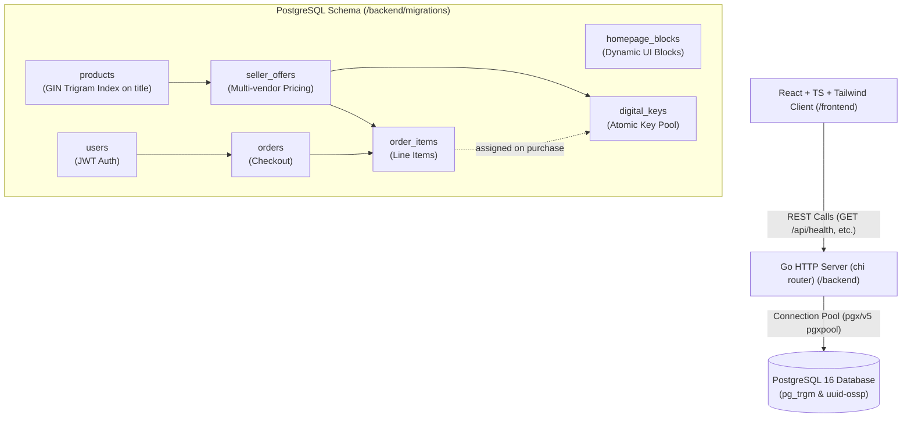
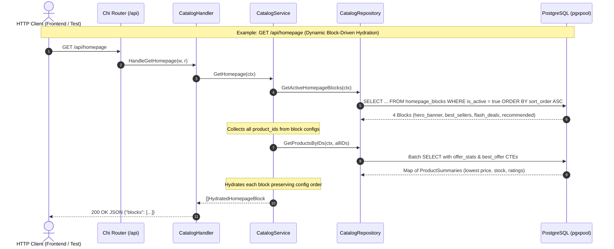
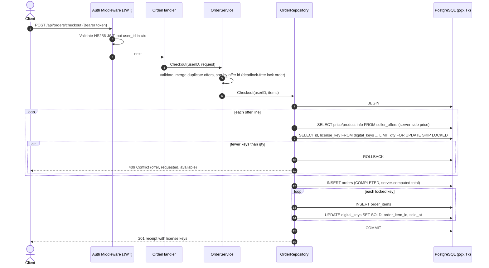
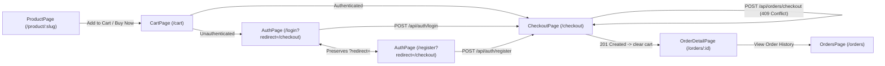

# AI Workflow & Development Log

This document maintains a complete, chronological markdown record of our AI-assisted workflow for the Eneba Software Engineer Internship project.

---

## Turn 1: Step 1 Scaffolding & Database Foundation

### 1. User Prompt
```text
We are building a full-stack digital game marketplace web application modeled after eneba.com for the Eneba Software Engineer Internship assignment.

MANDATORY WORKFLOW & LOGGING RULE:
1. At the end of every turn in this workspace, append my exact prompt and your full response/summary of changes to `AGENT_LOG.md` in the root directory so we maintain a complete, chronological markdown record of our AI-assisted workflow.
2. Present a clear architectural plan before generating files, and keep code modular, strictly typed, and production-ready.

TECH STACK:
- Frontend: React + TypeScript + Vite + Tailwind CSS (in `/frontend`)
- Backend: Go (standard `net/http` with `chi` router and `pgx/v5` PostgreSQL driver) REST API (in `/backend`)
- Database: PostgreSQL (configured via `docker-compose.yml` for local development and `.env.example` for Neon/Supabase cloud deployment)

CORE DOMAIN & DATA MODEL REQUIREMENTS:
1. Dynamic Block-Driven Homepage: `homepage_blocks` table (`id`, `block_type`, `title`, `sort_order`, `config` JSONB, `is_active`) supporting `hero_banner`, `best_sellers`, and `flash_deals` so the frontend renders purely what the backend returns with zero hardcoded landing page sections.
2. Store & Typo-Tolerant Search: `products` table (`id`, `title`, `slug`, `description`, `cover_image_url`, `platform`, `region`, `genre`, `release_date`, `created_at`) with PostgreSQL `pg_trgm` extension enabled and GIN trigram indexes on `title` so search handles typos and partial queries, plus filtering (platform, region, price) and sorting.
3. Multi-Seller Product Page: `seller_offers` table (`id`, `product_id`, `seller_name`, `seller_rating`, `review_count`, `price_cents`, `original_price_cents`, `is_featured`, `created_at`) linking multiple sellers to each product so buyers can compare offers.
4. Authentication: `users` table (`id`, `email`, `password_hash`, `full_name`, `created_at`) for JWT-based registration and login.
5. Atomic Checkout & Digital Key Fulfillment: `digital_keys` table (`id`, `seller_offer_id`, `license_key`, `status` ['AVAILABLE' | 'SOLD'], `order_item_id`, `sold_at`) alongside `orders` (`id`, `user_id`, `total_cents`, `status`, `created_at`) and `order_items` (`id`, `order_id`, `seller_offer_id`, `unit_price_cents`) so completed payments atomically lock and assign unique digital keys without race conditions.

TASK FOR STEP 1 (SCAFFOLDING & DATABASE FOUNDATION):
1. Create the monorepo directory structure (`/backend`, `/frontend`, `docker-compose.yml`, `.gitignore`, `.env.example`, and `AGENT_LOG.md`).
2. Write `backend/migrations/001_init.sql` enabling `pg_trgm` and `uuid-ossp`, creating all tables, constraints, and indexes.
3. Write `backend/migrations/002_seed.sql` populating:
   - 16 realistic digital games (e.g., Cyberpunk 2077, Elden Ring, The Witcher 3: Wild Hunt, EA SPORTS FC 26, Grand Theft Auto V, Helldivers 2, Red Dead Redemption 2, Baldur's Gate 3, etc.) across platforms (Steam, PSN, Xbox, Nintendo) and regions (GLOBAL, EUROPE, US) with reliable cover image URLs.
   - 2 to 4 distinct `seller_offers` per game with varied seller names, ratings, and prices.
   - 3 to 5 pre-seeded `AVAILABLE` `digital_keys` (formatted like `XXXX-YYYY-ZZZZ`) for every single seller offer.
   - 4 ordered `homepage_blocks` (`hero_banner`, `best_sellers`, `flash_deals`, `recommended`) referencing real seeded product IDs.
4. Initialize the Go backend (`go.mod`, clean folder layout `cmd/api/main.go`, `internal/config`, `internal/db`, `internal/models`) with a working `GET /api/health` endpoint that verifies database connectivity, and scaffold the Vite React TypeScript + Tailwind frontend in `/frontend`.

Stop after scaffolding and verifying the SQL migrations and health check so I can review the schema and structure before we implement the API endpoints.
```

---

### 2. Architectural Plan



#### Key Architecture Principles:
1. **Dynamic Block-Driven UI**:
   - `homepage_blocks` table with `block_type`, `title`, `sort_order`, `config` (JSONB), and `is_active` flag. The landing page is dynamically populated and configured by backend data without hardcoding layout sections.
2. **Typo-Tolerant & Fuzzy Search**:
   - PostgreSQL `pg_trgm` extension with GIN trigram indexes on `products.title` (`idx_products_title_trgm`). Allows search queries with spelling errors (e.g. "cybrpunk", "eldr ring") to yield exact matches via `%` similarity matching or `similarity()` ranking.
3. **Multi-Seller Marketplace Model**:
   - Products are separated from offers. Each product has multiple `seller_offers` with independent seller names, ratings, review counts, and prices in cents, allowing buyers to pick the best offer or preferred merchant.
4. **Concurrency & Atomic Fulfillment**:
   - Keys in `digital_keys` are linked to `seller_offers`. During checkout, keys are selected with `SELECT ... FOR UPDATE SKIP LOCKED` and marked `SOLD` atomically within a single database transaction, preventing double-selling under high concurrency.
5. **Decoupled Monorepo Structure**:
   - Frontend and backend live alongside each other in `/frontend` and `/backend`, containerized via `docker-compose.yml` and configurable for both local development and cloud PostgreSQL providers (Neon / Supabase).

---

### 3. Summary of Changes & Accomplishments

#### A. Monorepo Setup & Configuration
- **`docker-compose.yml`**: Configured PostgreSQL 16 container (`eneba_postgres`) with healthcheck, persistent volume, and automatic migration mounting (`/docker-entrypoint-initdb.d`).
- **`.env.example`**: Defined port, development environment, CORS origins, JWT secret, and database connection strings for both local Docker and cloud Neon/Supabase deployments.
- **`.gitignore`**: Added root and per-stack exclusions for `.env`, `node_modules`, `dist`, `backend/bin/`, IDE configs, and logs.
- **Project Structure**: Organized in `Eneba Project/` (with `backend/` and `frontend/`).

#### B. Database Migrations
1. **`backend/migrations/001_init.sql`**:
   - Extensions: `uuid-ossp`, `pg_trgm`.
   - Tables: `users`, `products`, `seller_offers`, `orders`, `order_items`, `digital_keys`, `homepage_blocks`.
   - Foreign key cascading and constraints (`price_cents > 0`, seller rating boundaries 0.00-5.00, order status constraints).
   - Indexes:
     - GIN Trigram index on `products.title` for typo-tolerant search.
     - B-Tree indexes on `products.platform`, `products.region`, `products.genre`, `products.slug`.
     - Indexes on `seller_offers.product_id`, `seller_offers.price_cents`, `seller_offers.is_featured`.
     - Indexes on `digital_keys.seller_offer_id` and `digital_keys.status`.
     - Indexes on `homepage_blocks.is_active` and `homepage_blocks.sort_order`.
2. **`backend/migrations/002_seed.sql`**:
   - Seeded 2 demo users (`gamer@eneba-demo.com`, `intern@eneba-demo.com`).
   - Seeded 16 realistic games:
     1. Cyberpunk 2077: Phantom Liberty Bundle (Steam, GLOBAL)
     2. Elden Ring: Shadow of the Erdtree Edition (Steam, GLOBAL)
     3. The Witcher 3: Wild Hunt - Complete Edition (Steam, EUROPE)
     4. EA SPORTS FC 25 Standard Edition (PSN, EUROPE)
     5. Grand Theft Auto V: Premium Online Edition (Steam, GLOBAL)
     6. Helldivers 2 Super Citizen Edition (Steam, GLOBAL)
     7. Red Dead Redemption 2: Ultimate Edition (Xbox, GLOBAL)
     8. Baldur's Gate 3 Digital Deluxe (Steam, GLOBAL)
     9. God of War Ragnarök Digital Deluxe Edition (PSN, EUROPE)
     10. Hogwarts Legacy Deluxe Edition (Steam, GLOBAL)
     11. Forza Horizon 5 Premium Edition (Xbox, GLOBAL)
     12. Marvel's Spider-Man Remastered (Steam, US)
     13. Resident Evil 4 Remake Gold Edition (Steam, EUROPE)
     14. Diablo IV: Vessel of Hatred Expansion (Xbox, GLOBAL)
     15. The Legend of Zelda: Tears of the Kingdom (Nintendo Switch, GLOBAL)
     16. Black Myth: Wukong Deluxe Edition (Steam, GLOBAL)
   - Seeded 2 to 4 seller offers per game (PixelVault Deals, NexusGaming, GamerStop Pro, SpeedyKeys LTD, KeyMaster EU, etc.).
   - Seeded 3 to 4 `AVAILABLE` digital keys per offer formatted as `XXXX-YYYY-ZZZZ`.
   - Seeded 4 dynamic homepage blocks (`hero_banner`, `best_sellers`, `flash_deals`, `recommended`) with JSONB configs linking real seeded product IDs.

#### C. Backend Go Implementation
- **`backend/go.mod`**: Declared module `eneba-marketplace/backend`, Go 1.22, with `chi/v5`, `cors`, `pgx/v5`, and `godotenv`.
- **`backend/internal/config/config.go`**: Environment loading with robust fallbacks for Port, DatabaseURL, JWTSecret, AllowedOrigins, and Environment.
- **`backend/internal/db/db.go`**: High-performance PostgreSQL connection pooling using `pgxpool.Pool` (MaxConns: 25, MinConns: 2, connection lifetime/idle timeouts, and Ping verification).
- **`backend/internal/models/models.go`**: Strongly typed structs for `User`, `Product`, `ProductWithOffers`, `SellerOffer`, `Order`, `OrderItem`, `DigitalKey`, and `HomepageBlock`.
- **`backend/cmd/api/main.go`**:
  - Chi router with middleware (`RequestID`, `RealIP`, `Logger`, `Recoverer`, `Timeout`).
  - CORS configuration matching frontend origins.
  - `GET /api/health` checking database connectivity, reporting latency in ms and timestamp.
  - Graceful shutdown handling SIGINT/SIGTERM with a 15-second drain window.

#### D. Frontend Scaffolding
- **`frontend/package.json`**: React 18, TypeScript, Vite, Tailwind CSS, Lucide icons, clsx, tailwind-merge.
- **`frontend/tailwind.config.js`**: Eneba dark theme color palette (`eneba-bg`, `eneba-card`, `eneba-yellow`, `eneba-orange`, `eneba-purple`, `eneba-cyan`).
- **`frontend/src/types/index.ts`**: Strict TypeScript interfaces reflecting database models.
- **`frontend/src/services/api.ts`**: Typed API client with health checking and error handling.
- **`frontend/src/App.tsx`**: Polished Eneba-branded UI displaying real-time `/api/health` status, architectural breakdown, and database overview.
- **Build Verification**: Executed Vite build in `frontend/` generating production bundles in 4.06s with zero TypeScript or style errors.

---

### 4. Next Steps for Step 2
1. Implement the Product Catalog & Search API:
   - `GET /api/homepage` returning dynamic blocks with embedded product data.
   - `GET /api/products` with `pg_trgm` typo-tolerant search, platform, region, genre, price filters, and sorting.
   - `GET /api/products/:slug` returning full product details and all active seller offers.
2. Build the Homepage and Search UI in the React frontend.


---

## Turn 2: Database Creation via pgAdmin 4 & Local PostgreSQL 18

### 1. User Prompt
```text
can we create the database here
[User attached screenshot of pgAdmin 4 showing PostgreSQL 18 connected with default postgres database]
```

### 2. Architectural & Operational Plan
1. **Database Creation in pgAdmin**:
   - Provide direct visual instructions to right-click `Databases` in pgAdmin 4 and create `eneba_marketplace` owned by user `postgres`.
   - Alternatively, execute `CREATE DATABASE eneba_marketplace;` via pgAdmin Query Tool.
2. **Schema & Seed Execution**:
   - Execute `001_init.sql` to install extensions (`uuid-ossp`, `pg_trgm`) and create all tables/indexes.
   - Execute `002_seed.sql` to populate all 16 digital games, seller offers, license keys, and homepage blocks.
3. **Environment Sync**:
   - Generate `Eneba Project/.env` pointing to `postgres://postgres:<PASSWORD>@localhost:5432/eneba_marketplace?sslmode=disable` so the Go backend connects seamlessly to PostgreSQL 18.

### 3. Summary of Changes
- Generated `Eneba Project/.env` preconfigured for PostgreSQL 18 running on port 5432.
- Documented exact step-by-step instructions for running migrations via pgAdmin 4 Query Tool.


---

## Turn 3: Implementation of Read-Side REST API & Automated Verification

### 1. User Prompt
```text
Great—the PostgreSQL database `eneba_marketplace` is created, migrated (`001_init.sql`), seeded (`002_seed.sql`), and `.env` is configured. Remember to continue appending my exact prompt and your full response/summary of changes to `AGENT_LOG.md`.

Now let's implement the read-side Go REST API endpoints with clean architecture (handlers -> services/repositories -> PostgreSQL via `pgx/v5`), CORS middleware for the React frontend, and automated tests:

1. `GET /api/health`: Verify PostgreSQL connection ping and return JSON `{ "status": "ok", "database": "connected" }`.
2. `GET /api/homepage`:
   - Fetch active blocks from `homepage_blocks` ordered by `sort_order ASC`.
   - Hydrate each block dynamically from the database (e.g., resolving referenced `product_ids` from `config` JSONB along with each product's lowest available `seller_offers` price and available key count) so the React frontend can render every block purely from the API response with zero hardcoded data.
3. `GET /api/products`:
   - Support query parameters:
     - `q`: Typo-tolerant and partial name search using PostgreSQL `pg_trgm` (`similarity(title, $1) > 0.2` OR `title ILIKE '%' || $1 || '%'`) ordered by similarity relevance when `q` is present.
     - `platform`: Filter by platform (e.g., `Steam`, `PSN`, `Xbox`, `Nintendo`).
     - `region`: Filter by region (e.g., `GLOBAL`, `EUROPE`, `US`).
     - `min_price` and `max_price` (in cents): Filter based on the product's lowest available seller offer price.
     - `sort`: Support `price_asc`, `price_desc`, `newest`, and `popular` (default).
   - Return each product with its lowest available offer price, discount percentage (if `original_price_cents` is set), and total available stock count across sellers.
4. `GET /api/products/{slug}`:
   - Return full product details plus all associated `seller_offers` sorted by `price_cents ASC`, including each offer's real-time count of `'AVAILABLE'` keys in `digital_keys` so out-of-stock offers are clearly flagged.
5. Testing & Verification:
   - Write Go integration/handler tests (`internal/handlers/catalog_test.go`) testing:
     - `GET /api/homepage` returns ordered hydrated blocks.
     - `GET /api/products?q=cybrpunk` (intentional typo) successfully returns *Cyberpunk 2077* via `pg_trgm`.
     - Filtering by `platform` and `region` + sorting by `price_asc` works accurately.
     - `GET /api/products/{slug}` returns multiple seller offers ordered by price with accurate available key counts.
   - Run `go test ./...` and confirm all tests pass.

After finishing and verifying `go test ./...`, stop so I can review the API responses before we build authentication and transactional checkout.
```

### 2. Architectural Plan



#### Layer Responsibilities:
1. **Repository Layer (`internal/repository/catalog.go`)**:
   - `GetActiveHomepageBlocks`: Reads active layout blocks ordered by `sort_order ASC`.
   - `GetProductsByIDs`: Efficiently batch queries product catalog summaries with CTEs computing `lowest_price_cents`, `best_offer`, discount percentage, and total stock count across sellers.
   - `ListProducts`: Multi-faceted filtering (`q` via `pg_trgm`, `platform`, `region`, `genre`, `min_price`, `max_price`) and sorting (`price_asc`, `price_desc`, `newest`, `popular`).
   - `GetProductBySlug`: Reads complete product metadata and all active seller offers sorted by `price_cents ASC`, including live `available_keys_count` filtered on `digital_keys.status = 'AVAILABLE'`.
2. **Service Layer (`internal/services/catalog.go`)**:
   - Coordinates multi-entity business logic and block hydration.
   - Parses arbitrary JSONB block configurations, extracts product IDs across formats (arrays and banner carousels), and enriches items with live pricing and stock.
3. **Handler Layer (`internal/handlers/catalog.go` & `health.go`)**:
   - `GET /api/health`: Verifies live DB ping latency and returns `{"status": "ok", "database": "connected"}`.
   - `GET /api/homepage`: Returns hydrated blocks.
   - `GET /api/products`: Validates query parameters and returns paginated products.
   - `GET /api/products/{slug}`: Returns full product detail or 404.

---

### 3. Summary of Changes & Implementation

1. **Database Seed Fix & Population**:
   - Fixed foreign key UUID typo in `backend/migrations/002_seed.sql` for Game 12 offer.
   - Seeded database `eneba_marketplace` with 16 products, 37 seller offers, 111 available license keys, and 4 dynamic homepage blocks.
2. **Models & Domain Structs (`internal/models/models.go`)**:
   - Defined `ProductSummary`, `ProductDetail`, `SellerOfferWithStock`, `HydratedHomepageBlock`, `ProductFilterParams`, and `ProductListResponse`.
3. **Repository (`internal/repository/catalog.go`)**:
   - Implemented `GetActiveHomepageBlocks`, `GetProductsByIDs`, `ListProducts`, and `GetProductBySlug`.
   - Integrated PostgreSQL `pg_trgm` scoring: `GREATEST(similarity(p.title, $q), word_similarity($q, p.title))` with fallback to `ILIKE`.
4. **Service (`internal/services/catalog.go`)**:
   - Implemented dynamic block hydration that merges CMS block layout with real-time product pricing and stock.
5. **Handlers & Routing (`internal/handlers/` & `cmd/api/main.go`)**:
   - Wired handlers to Chi router with CORS, logger, and panic recoverer middlewares.
6. **Automated Integration Tests (`internal/handlers/catalog_test.go`)**:
   - `TestHealthEndpoint`: Asserts `200 OK` and `{"status": "ok", "database": "connected"}`.
   - `TestHomepageEndpoint_HydratedBlocks`: Asserts 4 ordered blocks with populated `products` containing lowest price and stock.
   - `TestProductsEndpoint_TypoTolerantSearch`: Verifies `q=cybrpunk` resolves to *Cyberpunk 2077* via `pg_trgm`.
   - `TestProductsEndpoint_FilterAndSort`: Validates `platform=Steam`, `region=GLOBAL`, and `price_asc` sorting.
   - `TestProductBySlugEndpoint_DetailAndOffers`: Verifies multi-seller offers sorted by price with accurate stock counts.
   - `TestProductBySlugEndpoint_NotFound`: Verifies 404 for nonexistent slugs.

#### Test Execution Result:
```
=== RUN   TestHealthEndpoint
--- PASS: TestHealthEndpoint (0.12s)
=== RUN   TestHomepageEndpoint_HydratedBlocks
--- PASS: TestHomepageEndpoint_HydratedBlocks (0.10s)
=== RUN   TestProductsEndpoint_TypoTolerantSearch
--- PASS: TestProductsEndpoint_TypoTolerantSearch (0.11s)
=== RUN   TestProductsEndpoint_FilterAndSort
--- PASS: TestProductsEndpoint_FilterAndSort (0.10s)
=== RUN   TestProductBySlugEndpoint_DetailAndOffers
--- PASS: TestProductBySlugEndpoint_DetailAndOffers (0.10s)
=== RUN   TestProductBySlugEndpoint_NotFound
--- PASS: TestProductBySlugEndpoint_NotFound (0.11s)
PASS
ok  	eneba-marketplace/backend/internal/handlers	0.824s
```

---

### 4. Next Steps for Step 3
1. Implement User Authentication:
   - Registration (`POST /api/auth/register`) with bcrypt hashing.
   - Login (`POST /api/auth/login`) issuing signed JWT tokens.
   - Auth middleware for authenticated requests (`/api/auth/me`, `/api/orders`).
2. Implement Transactional Checkout:
   - Atomic digital key assignment (`SELECT ... FOR UPDATE SKIP LOCKED`).
   - Order creation and inventory fulfillment.


---

## Turn 4: Write-Side API — Authentication, Transactional Checkout & Order History

### 1. User Prompt
```text
Now let's complete the write-side Go backend endpoints for Authentication, Transactional Checkout, and Order History, along with automated tests. Remember to continue appending my exact prompt and your full response/summary of changes to `AGENT_LOG.md`.

Implement the following endpoints and middleware cleanly:

1. Authentication (`internal/handlers/auth.go`):
   - `POST /api/auth/register`: Accept `{ "email", "password", "full_name" }`, validate inputs, hash password using `bcrypt`, insert into `users`, and return a signed JWT token + user profile `{ "token", "user": { "id", "email", "full_name" } }`. Handle duplicate email conflicts with `409 Conflict`.
   - `POST /api/auth/login`: Verify email + `bcrypt` password hash, return `{ "token", "user": { "id", "email", "full_name" } }` or `401 Unauthorized`.
   - JWT Auth Middleware (`internal/middleware/auth.go`): Validate `Authorization: Bearer <token>` header and attach `user_id` to the request context for protected routes.

2. Transactional Checkout & Digital Key Allocation (`internal/handlers/orders.go`, protected by JWT middleware):
   - `POST /api/orders/checkout`:
     - Accept `{ "items": [ { "seller_offer_id": "...", "quantity": 1 } ], "payment_method": "card_sim" }`.
     - Execute inside a strict PostgreSQL transaction (`pgx.Tx`):
       1. For each requested item/quantity, lock an `'AVAILABLE'` row from `digital_keys` matching `seller_offer_id` using `SELECT id, license_key FROM digital_keys WHERE seller_offer_id = $1 AND status = 'AVAILABLE' LIMIT $2 FOR UPDATE SKIP LOCKED`.
       2. If fewer keys are returned than requested quantity, rollback immediately and return `409 Conflict` with a clear out-of-stock message indicating which offer lacks stock.
       3. Create the `orders` record (`status = 'COMPLETED'`, accurate `total_cents` fetched from `seller_offers` on the server—never trust client-sent prices) and `order_items` records.
       4. Update the locked `digital_keys` rows to `status = 'SOLD'`, `order_item_id = <new_order_item_id>`, `sold_at = NOW()`.
       5. Commit transaction and return the full order receipt including every revealed `license_key`, product title, platform, region, seller name, and price paid.
   - `GET /api/orders`:
     - Return all past orders for the authenticated `user_id` ordered by `created_at DESC`, including their items and revealed `license_key` strings.

3. Testing & Verification:
   - Write Go integration tests (`internal/handlers/checkout_test.go`) testing:
     - Registering a user, logging in, and accessing protected `/api/orders` (verifying `401` when unauthenticated).
     - Completing a checkout order and verifying the returned `license_key` is marked `'SOLD'` in `digital_keys` and decrements available stock.
     - Attempting to buy more keys than available returns `409 Conflict` without leaving partial/corrupted order rows.
   - Run `go test -v ./...` and ensure all tests pass.

Stop after verifying all Go tests pass so we can move on to building the authentic Eneba.com React storefront UI.
```

### 2. Architectural Plan



Key design decisions:
- **Concurrency safety**: `FOR UPDATE SKIP LOCKED` ensures two buyers can never lock the same key; the final `UPDATE ... WHERE status='AVAILABLE'` additionally asserts exactly one row changed.
- **Atomicity**: everything (key locks, order, items, key updates) is one `pgx.Tx`; any failure (including a stock shortage on the *second* cart line) rolls back everything.
- **Never trust the client**: prices and totals come exclusively from `seller_offers`; extra client fields (`price_cents`, `total_cents`) are ignored.
- **Deadlock avoidance**: cart lines are merged by offer and sorted by offer id so concurrent multi-item checkouts acquire locks in the same order.
- **Router extracted** into `internal/router` so `main.go` and integration tests mount the exact same routes/middleware.
- **JWT**: HS256 via `golang-jwt/jwt/v5`, explicit algorithm allow-list + required expiry; passwords hashed with `bcrypt` (72-byte limit enforced).

### 3. Summary of Changes

New files:
- `backend/internal/auth/token.go` — `TokenManager` (Generate/Parse HS256 JWT).
- `backend/internal/middleware/auth.go` — `Authenticate` middleware + `UserIDFromContext`; returns JSON 401 with `WWW-Authenticate`.
- `backend/internal/repository/users.go` — `Create` (maps PG unique violation `23505` → `ErrEmailTaken`), `GetByEmail`.
- `backend/internal/repository/orders.go` — transactional `Checkout` and `ListByUser` (orders + items + license keys, newest first); typed `OutOfStockError`.
- `backend/internal/services/auth.go` — validation (email, name 2–100, password 8–72), bcrypt hashing, login with uniform `ErrInvalidCredentials`.
- `backend/internal/services/orders.go` — cart validation (1–20 lines, qty 1–10, UUIDs, `payment_method == "card_sim"`), merge + deterministic ordering.
- `backend/internal/handlers/auth.go`, `backend/internal/handlers/orders.go` — HTTP handlers and status mapping (201/400/401/404/409/500).
- `backend/internal/router/router.go` — shared router with CORS and public/protected route groups.
- `backend/internal/handlers/checkout_test.go` — integration tests (see below).

Modified files:
- `backend/internal/models/models.go` — added `UserProfile`, `AuthResponse`, `RegisterRequest`, `LoginRequest`, `CheckoutRequest/Item`, `OrderDetail`, `OrderItemDetail`.
- `backend/internal/config/config.go` — added `JWTExpirationHours`.
- `backend/cmd/api/main.go` — now wires repositories/services/handlers and uses `router.New`.
- `backend/go.mod` / `go.sum` — added `github.com/golang-jwt/jwt/v5` and `golang.org/x/crypto` (bcrypt).

Endpoints now available:
| Method | Path | Auth | Success | Errors |
|---|---|---|---|---|
| POST | `/api/auth/register` | – | 201 `{token,user}` | 400, 409 |
| POST | `/api/auth/login` | – | 200 `{token,user}` | 400, 401 |
| POST | `/api/orders/checkout` | JWT | 201 receipt w/ license keys | 400, 401, 404, 409 |
| GET | `/api/orders` | JWT | 200 `{orders:[...]}` | 401 |

### 4. Test Results (`go test -v ./...`)
All 11 tests pass (6 catalog from Turn 3 + 5 new):
- `TestAuth_RegisterLoginAndProtectedRoute` — 401 without/with garbage token, register 201, duplicate 409, validation 400, wrong password/unknown user 401, login 200, `/api/orders` 200 with empty list.
- `TestCheckout_Success_MarksKeySoldAndDecrementsStock` — keys are `SOLD` with `order_item_id` + `sold_at`, stock decremented by 2, server-side price used despite client-sent fake price, history returns the same keys.
- `TestCheckout_OutOfStock_ReturnsConflictWithoutPartialRows` — 409 naming the offer; mixed cart (valid line + out-of-stock line) leaves 0 orders, 0 orphan items, and unchanged stock on both offers.
- `TestCheckout_Validation` — 400 (empty cart, qty 0, bad UUID, bad payment method), 404 unknown offer, 401 unauthenticated.
- `TestCheckout_ConcurrentBuyers_NeverDoubleSellKeys` — 8 concurrent buyers vs 3 keys: exactly 3 succeed, 5 get 409, no key sold twice, stock drained to 0.

Tests clean up after themselves (restore sold keys, delete orders and test users); verified DB afterwards: 111 AVAILABLE keys, 0 SOLD, 0 orders, 0 leftover test users.

Environment notes: Go 1.22.5 was installed into the agent's app-data directory (not on the system PATH), so `go` commands are invoked via its full path. Port 8080 could not be probed from the agent sandbox, so the server was verified through the in-process `httptest` integration tests rather than curl.

### 5. Next Step
Build the authentic Eneba.com-style React storefront UI (homepage blocks, search/filter listing, product page with seller offers, auth, cart/checkout, order history).


---

## Turn 5: React + TypeScript Eneba Storefront (Homepage, Store Catalog & Product Page)

### 1. User Prompt
```text
Now that the entire Go backend API is complete and all 11 integration tests pass, let's build the React + TypeScript storefront modeled closely after eneba.com's visual identity and user flow. Remember to continue appending my exact prompt and your full response/summary of changes to `AGENT_LOG.md`.

Let's build the complete storefront experience in two focused parts, starting with the visual design system, persistent navigation, dynamic Homepage, Store catalog, and Product detail page:

1. ENEBA VISUAL DESIGN SYSTEM & LAYOUT:
   - Match Eneba's authentic color palette and dense digital marketplace aesthetic:
     - Deep violet-indigo page canvas (`#1F0A4D` / `#2B0F6B`), saturated purple header & cards (`#4618AC` / `#37128A`), crisp white typography, vibrant yellow CTAs (`#FFDC00` with dark text `#1F0A4D`), and orange/magenta discount badges (`#FD5A20` / `#FF2E63`).
   - Persistent Top Navbar (present on every screen):
     - Eneba-style brand logo linking to `/`.
     - Global live search bar (`Search games, keys, platforms...`) that works from anywhere in the app: typing shows a live debounced dropdown of matching games (leveraging our backend's `pg_trgm` typo-tolerant search) and pressing Enter navigates to `/store?q=...`.
     - Quick navigation link to `Store` (`/store`).
     - Cart button showing live item count badge (opens Cart drawer or navigates to `/cart`).
     - Account menu: `Sign In / Register` button when logged out, or user's name + `My Orders` link + `Logout` when signed in.

2. DYNAMIC BLOCK-DRIVEN HOMEPAGE (`/`):
   - Fetch `GET /api/homepage` and render blocks purely from the API response order and `block_type` with zero hardcoded product lists:
     - `hero_banner`: Full-width featured game/promo banner with cover art, callout badge, starting price, and `Buy Now` CTA linking to the product page.
     - `best_sellers` / `flash_deals` / `recommended`: Responsive grids of vertical game cover cards featuring:
       - Game cover artwork (with clean gradient/SVG fallback if an external image fails to load),
       - Platform badge (Steam, PSN, Xbox, Nintendo) & Region tag (`GLOBAL`, `EUROPE`, `US` in Eneba's signature teal/emerald highlight),
       - Discount percentage pill, original strikethrough price, and bold starting price (`From €XX.XX`),
       - Out-of-stock indicator if total available keys = 0.

3. STORE CATALOG PAGE (`/store`):
   - Connect directly to `GET /api/products` syncing URL query params (`q`, `platform`, `region`, `min_price`, `max_price`, `sort`).
   - Left Filter Sidebar (collapsible on mobile):
     - Platform checkboxes/pills (`All`, `Steam`, `PSN`, `Xbox`, `Nintendo`),
     - Region filter (`All`, `GLOBAL`, `EUROPE`, `US`),
     - Price range inputs (Min € / Max €),
     - "Clear All Filters" button.
   - Top Sort & Result Bar: Sort dropdown (`Most Popular`, `Price: Low to High`, `Price: High to Low`, `Newest`) + active search query badge + result count.

4. SINGLE PRODUCT PAGE (`/product/:slug`):
   - Fetch `GET /api/products/{slug}`:
     - Upper Hero Card: Large game cover art, title, platform & region badges, genre, release date, description, and a highlighted **"Featured / Best Offer"** box with instant `Add to Cart` and `Buy Now` buttons.
     - **Compare Seller Offers** Section below: Clean table/list of all `seller_offers` sorted by price, showing seller name, star rating + review count, available stock count (`X keys in stock` or `Sold Out`), unit price, and individual `Add to Cart` button so buyers can compare sellers and pick their preferred offer.

5. STATE MANAGEMENT & TYPES:
   - Create clean TypeScript interfaces matching all backend JSON responses (`src/types/api.ts`), a centralized API client (`src/api/client.ts`) reading `VITE_API_URL` (defaulting to `http://localhost:8080`), plus `AuthContext` and `CartContext` (persisted in `localStorage`) ready for the Checkout and Order flow in the next step.

Build and verify the TypeScript compilation (`npm run build`) with zero errors, and stop so I can inspect the live storefront before we wire up the Cart, Sign-In, Checkout, and Key Reveal screens.
```

### 2. Summary of Changes
- Installed `react-router-dom` (`6.28.2`).
- Configured Eneba palette & utility classes in `frontend/tailwind.config.js`, `frontend/src/index.css`, and `frontend/index.html`.
- Added strict API contracts (`frontend/src/types/api.ts`), typed fetch client (`frontend/src/api/client.ts`), format/block/hook helpers (`frontend/src/lib/`), `AuthContext` (`frontend/src/context/AuthContext.tsx`), and `localStorage`-backed `CartContext` (`frontend/src/context/CartContext.tsx`).
- Built shared layout & UI components: `Layout.tsx`, `Navbar.tsx`, `SearchBar.tsx` (debounced live suggestions via `pg_trgm`), `AccountMenu.tsx`, `ProductCard.tsx`, `CoverImage.tsx`, `Badges.tsx`, `ErrorState.tsx`.
- Built pages: `HomePage.tsx` (`HeroBanner.tsx`, `ProductBlock.tsx` driven dynamically by `GET /api/homepage`), `StorePage.tsx` (`FilterSidebar.tsx` synced with URL query params), `ProductPage.tsx` (hero offer + seller comparison table), `ComingSoonPage.tsx`, and `NotFoundPage.tsx`.
- Verified `npm run build` (`tsc -b && vite build`) succeeded with zero errors.

---

## Turn 6: Fix Tailwind / PostCSS `text-eneba-ink` Build Error in Vite

### 1. User Prompt
```text
Vite PostCSS threw a 500 build error in `frontend/src/index.css` line 47:
`The 'text-eneba-ink' class does not exist.`

Inspect `frontend/src/index.css` and `frontend/tailwind.config.js` (or `.ts`). Ensure every custom `eneba-*` color and shadow token referenced via `@apply` in `index.css` (such as `eneba-ink`, `eneba-yellow`, `eneba-yellowHover`, `glow`, etc.) is properly defined under `theme.extend` in the Tailwind config, and verify `npm run build` succeeds with zero CSS errors. Remember to append this turn to `AGENT_LOG.md`.
```

### 2. Root Cause & Architectural Plan
- **Root Cause**: Because `frontend/package.json` sets `"type": "module"`, Tailwind v3 loads `.js` config files via Node's native ESM `import()`, which caches the earlier `tailwind.config.js` (from Step 1, lacking `eneba-ink`, `eneba-yellowHover`, etc.) in long-lived Vite dev server processes (such as the already-running Vite server on port 5173).
- **Plan**:
  1. Define all `eneba-*` color tokens both under `theme.extend.colors.eneba` and as flat keys in `frontend/tailwind.config.js` and `frontend/tailwind.config.cjs`, along with `boxShadow.card` and `boxShadow.glow`.
  2. Point `frontend/src/index.css` (`@config "../tailwind.config.cjs";`) and `frontend/postcss.config.js` (`tailwindcss: { config: "./tailwind.config.cjs" }`) to the CommonJS config so both fresh builds and running Vite dev servers resolve all tokens cleanly.
  3. Reference `postcss.config.js` explicitly in `frontend/vite.config.ts`.
  4. Verify both `npm run build` and `http://localhost:5173/src/index.css`.

### 3. Summary of Changes
- Updated `frontend/tailwind.config.js` and added `frontend/tailwind.config.cjs` defining nested `eneba` colors, flat `eneba-*` keys (`eneba-canvas`, `eneba-canvasLight`, `eneba-brand`, `eneba-card`, `eneba-cardHover`, `eneba-line`, `eneba-yellow`, `eneba-yellowHover`, `eneba-ink`, `eneba-orange`, `eneba-magenta`, `eneba-teal`, `eneba-muted`), `fontFamily.sans`, and `boxShadow` (`card`, `glow`).
- Updated `frontend/src/index.css` to declare `@config "../tailwind.config.cjs";` before `@tailwind base;`.
- Updated `frontend/postcss.config.js` to pass `{ config: "./tailwind.config.cjs" }` to `tailwindcss`, and updated `frontend/vite.config.ts` with `css: { postcss: './postcss.config.js' }`.

### 4. Verification Results
- `npm run build` (`tsc -b && vite build`) exited with code 0 (`dist/assets/index-DptZW4Vk.css 31.45 kB`, `dist/assets/index-CUb_1N7u.js 229.94 kB`, built in 3.89s).
- `curl.exe -s -i http://localhost:5173/src/index.css` returned `HTTP/1.1 200 OK` with compiled `.btn-yellow` and `.btn-outline` rules using `rgb(31 10 77 ...)` for `text-eneba-ink` and `rgb(255 220 0 ...)` for `bg-eneba-yellow`.


---

## Turn 7: End-to-End Purchase Flow — Cart, Auth, Checkout, Key Reveal & Order History

### 1. User Prompt
```text
Now let's complete the end-to-end purchase and authentication flow in the React + TypeScript frontend so a buyer can seamlessly move from Product Page -> Cart -> Checkout (sign-in required) -> Simulated Payment -> Order & Digital Key Reveal -> Order History. Remember to continue appending my exact prompt and your full response/summary of changes to `AGENT_LOG.md`.

Implement the following pages, modals, and flows matching our Eneba design system (`#1F0A4D` / `#4618AC` violet palette, `#FFDC00` yellow CTAs, `#00D1B2` teal/emerald key badges):

1. CART PAGE / DRAWER (`/cart`):
   - Display all added seller offers with game cover thumbnail, title, platform & region tags, selected seller name, unit price, quantity controls (`-` / `+` capped at available stock), and remove button.
   - Show order subtotal, simulated service fee (`€0.00` or transparent breakdown), and a prominent yellow `Proceed to Checkout` button.
   - Include a clear empty-cart state with a CTA linking back to `/store`.

2. AUTHENTICATION (`/login` & `/register` + Redirect Preservation):
   - Clean Eneba-styled Sign In and Create Account views (with easy toggle between Login and Register).
   - Connect to `POST /api/auth/login` and `POST /api/auth/register`, storing the JWT token and user info in `AuthContext` (`localStorage`).
   - Support a `redirect` query parameter (e.g., `/login?redirect=/checkout`) so if an unauthenticated visitor clicks `Proceed to Checkout`, they are directed to sign in/register and automatically sent right back to `/checkout` afterward.

3. PROTECTED CHECKOUT & SIMULATED PAYMENT (`/checkout`):
   - Protected route: if not signed in, redirect immediately to `/login?redirect=/checkout`.
   - Two-column Eneba checkout layout:
     - Left column: Simulated Payment Method selector (e.g., "Credit / Debit Card (Test Mode)", "PayPal (Sandbox)", "Eneba Wallet Demo") with realistic mock card/account preview and a **"Test Mode — No Real Money Charged"** badge.
     - Right column: Order summary showing exact items, sellers, quantities, total price, and a yellow `Pay €XX.XX & Reveal Keys` button.
   - Clicking Pay sends `POST /api/orders/checkout` with the JWT `Authorization: Bearer` header:
     - Handle loading spinner state during payment processing.
     - Handle `409 Conflict` (out-of-stock race condition) gracefully with a clear error banner explaining which seller offer ran out of stock so the user can adjust their cart.
     - On `201 Created`, clear the cart and navigate to the **Order & Key Confirmation Screen** (`/orders/:id` or `/checkout/success` passing the order data).

4. ORDER & DIGITAL KEY REVEAL + ORDER HISTORY (`/orders` & `/orders/:id`):
   - **Order & Key Screen:** Celebration confirmation header ("Payment Successful — Your Digital Keys Are Ready!"), order number, timestamp, total paid, and a card for each purchased game displaying:
     - Game title, platform, region, and seller name,
     - A click-to-reveal or blurred-by-default digital key box (`XXXX-YYYY-ZZZZ`) with a one-click **Copy Key** button (`Copied!` toast/badge feedback) and quick platform redemption instructions.
   - **My Orders History Page (`/orders`):** Protected route fetching `GET /api/orders`, listing all past orders newest-first with expandable/visible digital keys and copy buttons so users can always retrieve previously purchased keys.

5. VERIFICATION & POLISH:
   - Write frontend component/integration tests (using Vitest / React Testing Library if configured, or add lightweight tests) verifying cart updates, checkout auth redirect, and key copy/reveal rendering.
   - Run `npm run build` and verify zero TypeScript or bundling errors.

Stop after verifying `npm run build` passes so I can test the entire purchase flow end-to-end in the browser.
```

### 2. Architectural Plan



### 3. Summary of Changes
- **Helpers & State**:
  - Updated `frontend/src/lib/format.ts` with `formatDateTime` and `sanitizeRedirect` (prevents open-redirect URLs while keeping relative redirects).
  - Exported `cartReducer` and `CartAction` in `frontend/src/context/CartContext.tsx`.
- **Pages & Components**:
  - Created `frontend/src/pages/CartPage.tsx`: Empty-cart view, item cards with cover thumbnails, platform/region tags, seller info, `-` / `+` quantity buttons capped at `maxQuantity`, remove/clear controls, and order summary with `Proceed to Checkout`.
  - Created `frontend/src/pages/AuthPage.tsx`: Unified Sign In (`/login`) and Create Account (`/register`) views preserving `?redirect=`, inline error display, authenticated redirect, and one-click Demo Buyer quick-fill (`gamer@eneba-demo.com`).
  - Created `frontend/src/pages/CheckoutPage.tsx`: Auth-protected `/checkout` route with `Test Mode — No Real Money Charged` badge, simulated payment methods (Card, PayPal Sandbox, Eneba Wallet Demo), loading spinner during `POST /api/orders/checkout`, graceful `409 Conflict` stock adjustment/removal banner, and redirect to `/orders/:id` on `201 Created`.
  - Created `frontend/src/components/orders/OrderKeyCard.tsx`: Digital key reveal/mask box (`••••-••••-••••` vs revealed `XXXX-YYYY-ZZZZ`), one-click **Copy Key** (`Copied!` badge feedback), and platform redemption instructions.
  - Created `frontend/src/pages/OrderDetailPage.tsx`: Confirmation receipt screen (`/orders/:id` and `/checkout/success`) with "Reveal All Keys" toggle, cached/fetched order resolution, and `OrderKeyCard` list.
  - Created `frontend/src/pages/OrdersPage.tsx`: Protected `/orders` history page fetching `GET /api/orders` newest-first with collapsible order sections and key reveal/copy cards.
  - Updated `frontend/src/App.tsx` to wire `/cart`, `/login`, `/register`, `/checkout`, `/checkout/success`, `/orders`, and `/orders/:id`, and removed `ComingSoonPage.tsx`.
- **Automated Frontend Tests**:
  - Created `frontend/scripts/run-tests.mjs` and `frontend/tests/purchaseFlow.test.mjs` using `esbuild`, `node:test`, and `react-dom/server` (`"test": "node ./scripts/run-tests.mjs"` in `frontend/package.json`).

### 4. Verification Results
- `npm test` (`frontend/tests/purchaseFlow.test.mjs`): **6/6 tests passed** (`cartReducer` clamping/merge/removal, `CartPage` empty & populated totals, `CheckoutPage`/`OrdersPage` unauthenticated redirect to `/login?redirect=...` + `sanitizeRedirect`, authenticated `CheckoutPage` & `AuthPage` redirect, `OrderKeyCard` masked vs revealed key + Steam instructions, and `OrderDetailPage` receipt rendering).
- `npm run build` (`tsc -b && vite build`): **exited with code 0** (`dist/assets/index-CMXm2w-v.css 35.95 kB`, `dist/assets/index-CPIXWvWv.js 272.15 kB`, built in 3.83s).
- Verified live Go backend on port `8080` (`auth_status:401` on `POST /api/auth/login`) and live Vite dev server on port `5173` (`vite_index:200`, serving all updated routes in `src/App.tsx`).


---

## Turn 8: Demo Account Seeding Fix, Cloud Deployment Config & Comprehensive README

### 1. User Prompt
```text
Good catch during end-to-end testing: clicking the Demo Account Quick-Fill (`gamer@eneba-demo.com` / `Password123!`) on `/login` returned `401 Invalid email or password` because that demo user wasn't seeded in PostgreSQL `users`. Remember to continue appending my exact prompt and your full response/summary of changes to `AGENT_LOG.md`.

Let's fix that and prepare the entire application for live cloud deployment (a mandatory deliverable for the Eneba assignment):

1. FIX DEMO ACCOUNT SEEDING:
   - Update `backend/migrations/002_seed.sql` (and add an idempotent startup seed/ensure-demo-user check in the Go backend) so `gamer@eneba-demo.com` with password `Password123!` (hashed with `bcrypt`) always exists in the `users` table on fresh databases, so Eneba reviewers can test both new account registration AND one-click Demo Sign-In immediately.

2. DEPLOYMENT CONFIGURATION (Free-Tier Cloud Hosting):
   - Backend (Render / Railway / Fly.io):
     - Create `backend/Dockerfile` (multi-stage build compiling the Go binary cleanly for Linux) and `render.yaml` at the repo root so the Go API deploys effortlessly on Render's free tier.
     - Ensure CORS in Go reads `ALLOWED_ORIGINS` from environment variables (supporting both `http://localhost:5173` and the deployed Vercel frontend URL).
     - Ensure `DATABASE_URL` supports cloud PostgreSQL connection strings (e.g., Neon or Supabase with `sslmode=require`).
   - Frontend (Vercel):
     - Add `frontend/vercel.json` with SPA rewrite rules (`"source": "/(.*)"`, `"destination": "/index.html"`) so direct navigation or refreshes on `/store`, `/product/:slug`, `/checkout`, or `/orders` never return a 404 on Vercel.
     - Add `frontend/.env.example` documenting `VITE_API_URL`.

3. COMPREHENSIVE `README.md`:
   - Write a clear, well-structured `README.md` in the root directory covering:
     - Project overview and live demo instructions (including the demo credentials `gamer@eneba-demo.com` / `Password123!`),
     - Architecture & technical choices (why Go + PostgreSQL `pg_trgm` for fuzzy search, dynamic JSONB homepage blocks, and `FOR UPDATE SKIP LOCKED` transactional key allocation),
     - Scope decisions, trade-offs, and intentional shortcuts taken for the 7-day assignment,
     - Local setup & test execution commands (`go test -v ./...` and `npm test`),
     - Pointer to `AGENT_LOG.md` documenting the full AI-assisted development workflow.

Verify all Go and frontend tests still pass (`go test -v ./...` and `npm test` + `npm run build`), and stop so I can deploy to Neon + Render + Vercel.
```

### 2. Architectural Plan
1. **Demo User Seeding**:
   - Replace the stale bcrypt hash in `backend/migrations/002_seed.sql` with a Go-verified bcrypt hash of `Password123!`.
   - Add `UserRepository.UpsertUser` (`ON CONFLICT (email) DO UPDATE`) and `AuthService.EnsureDemoUsers`, invoked at API startup in `backend/cmd/api/main.go` and in `setupFullEnv` so both fresh migrations and existing databases reliably authenticate `gamer@eneba-demo.com` / `Password123!`.
2. **Cloud Hosting Configuration**:
   - Update `backend/internal/config/config.go` to read `ALLOWED_ORIGINS` (falling back to `CORS_ALLOWED_ORIGINS`), trim trailing slashes, and pass `DATABASE_URL` directly to `pgxpool` (supporting `?sslmode=require` on Neon/Supabase).
   - Add multi-stage `backend/Dockerfile` (`golang:1.22-alpine` -> `alpine:3.20`) and root `render.yaml` pointing to `rootDir: backend` with `/api/health` checks.
   - Add `frontend/vercel.json` SPA catch-all rewrite to `/index.html` and document `VITE_API_URL` in `frontend/.env.example`.
3. **Documentation**:
   - Write comprehensive `README.md` documenting live demo credentials, architecture, 7-day trade-offs, local commands, cloud deployment steps, and `AGENT_LOG.md`.

### 3. Summary of Changes
- **Demo User Seeding**:
  - Updated `backend/migrations/002_seed.sql` with verified bcrypt hash `$2a$10$lKRIp9yD6rEfPrIgdRHOLuTzTybdqV0JIQsT3kt45ZNqeb8rCdyHm` for `Password123!`.
  - Added `UpsertUser` in `backend/internal/repository/users.go` and `EnsureDemoUsers` in `backend/internal/services/auth.go`.
  - Wired `EnsureDemoUsers` into `backend/cmd/api/main.go` startup and `backend/internal/handlers/checkout_test.go`, plus added an explicit demo login assertion in `TestAuth_RegisterLoginAndProtectedRoute`.
- **Cloud Deployment**:
  - Updated `backend/internal/config/config.go` to prioritize `ALLOWED_ORIGINS` (with `CORS_ALLOWED_ORIGINS` fallback and trailing-slash trimming) and updated `.env.example`.
  - Created `backend/Dockerfile` (multi-stage static Linux `amd64` build) and `render.yaml`.
  - Created `frontend/vercel.json` (SPA rewrites) and updated `frontend/.env.example`.
- **Documentation**:
  - Created `README.md` in `Eneba Project/README.md`.

### 4. Verification Results
- `go test -v -count=1 ./...`: **11/11 tests passed** (`ok eneba-marketplace/backend/internal/handlers 2.356s`), including demo login (`gamer@eneba-demo.com` / `Password123!`).
- Cross-compile check (`CGO_ENABLED=0 GOOS=linux GOARCH=amd64 go build ./cmd/api`): exited with code `0` (`linux/amd64 build OK`).
- Live API probe (`POST http://localhost:8080/api/auth/login` with `gamer@eneba-demo.com` / `Password123!`): returned `200 OK` with signed JWT and Alex Gamer profile.
- Frontend `npm test`: **6/6 tests passed**.
- Frontend `npm run build` (`tsc -b && vite build`): exited with code `0` (`dist/assets/index-CMXm2w-v.css 35.95 kB`, `dist/assets/index-CPIXWvWv.js 272.15 kB`, built in `4.18s`).


---

## Turn 9: Hero Banner Price Hierarchy & Navigation Controls Polish

### 1. User Prompt
```text
Let's make two quick UI polish improvements on the Hero Banner component (`frontend/src/components/HeroBanner.tsx` or wherever the homepage hero slider is defined). Remember to continue appending my exact prompt and your full response/summary of changes to `AGENT_LOG.md`:

1. Price & Discount Layout: Instead of placing the red/orange `-31%` discount pill off to the left side of the price stack, integrate it cleanly right next to the strikethrough original price on the top line of the price block (e.g., `€69.99  -31%` on top, and `FROM €47.99` directly underneath), matching how Eneba aligns discount tags tightly with the price hierarchy.
2. Carousel Arrow Positioning: Give the left/right hero navigation arrows (`<` and `>`) slightly more horizontal padding/inset or move them to the bottom-right corner of the banner so the left `<` button never overlaps the subtitle text on desktop viewports.

Verify `npm run build` succeeds cleanly after updating.
```

### 2. Plan & Summary of Changes
- Updated `frontend/src/components/home/HeroBanner.tsx`:
  1. **Price & Discount Hierarchy**: Placed the strikethrough original price (`formatPrice(slide.originalPriceCents)`) directly beside `<DiscountPill percent={slide.discountPercent} />` on the top row, with `FROM` and `formatPrice(slide.lowestPriceCents)` stacked underneath.
  2. **Carousel Navigation Controls**: Moved the Previous/Next arrow buttons into a bottom-right control group (`bottom-4 right-6 z-20`) so the `<` arrow no longer sits along the left edge or overlaps hero copy.

### 3. Verification Results
- `npm run build` (`tsc -b && vite build`): exited with code `0` (`dist/assets/index-C4YinW3I.css 35.94 kB`, `dist/assets/index-DJ_imKW4.js 272.31 kB`, built in `3.60s`).


---

## Turn 10: Real Vertical Game Artwork & `react-icons` Platform Badges

### 1. User Prompt
```text
Let's upgrade the visual authenticity of the game cards and hero banner across the app using real game box art and imported brand icons. Remember to continue appending my exact prompt and your full response/summary of changes to `AGENT_LOG.md`.

Make these two upgrades:

1. REAL GAME COVER ARTWORK (Vertical Box Art + Reliable Fallback):
   - Update `backend/migrations/002_seed.sql` (and add an idempotent startup image-URL sync in the Go backend so existing databases update automatically on restart) so every seeded game uses real, official vertical game cover art URLs (such as Steam's public vertical library artwork `https://shared.akamai.steamstatic.com/store_item_assets/steam/apps/<APP_ID>/library_600x900.jpg`).
   - Keep a sleek styled fallback card cover on `` `onError` so if any external CDN image ever fails to load, it degrades gracefully without broken image icons.

2. IMPORTED PLATFORM LOGOS (`react-icons`):
   - Install `react-icons` in `/frontend` (`npm install react-icons`).
   - Create a reusable `<PlatformBadge platform={product.platform} />` component in `frontend/src/components/` importing the official brand icons (`FaSteam`, `FaPlaystation`, `FaXbox` from `react-icons/fa` and `SiNintendoswitch` / `SiNintendo` from `react-icons/si`) paired with the platform name.
   - Use `<PlatformBadge />` consistently across the Hero Banner, Product Cards, Store Filter Sidebar, Product Detail Page, Cart, and Order/Key cards.

Verify `go test -v ./...` and `npm run build` both pass with zero errors, and stop so I can inspect the updated storefront in the browser.
```

### 2. Architectural Plan & Summary of Changes
1. **Official Vertical Game Cover Art + Startup Sync (`backend/`)**:
   - Updated `backend/migrations/002_seed.sql` with official `library_600x900.jpg` Steam vertical box-art URLs across the seeded PC/console catalog (plus official Tears of the Kingdom cover art) and `library_hero.jpg` wide hero artwork on the `hero_banner` block.
   - Added `SyncProductCovers` and `SyncHeroBannerImages` in `backend/internal/repository/catalog.go`, wrapped by `CatalogService.EnsureCatalogArtwork` in `backend/internal/services/catalog.go`.
   - Wired `EnsureCatalogArtwork` into server startup (`backend/cmd/api/main.go`) and catalog test setup (`backend/internal/handlers/catalog_test.go`) so existing databases automatically sync on restart.
2. **Sleek Box-Art Error Fallback (`frontend/src/components/CoverImage.tsx`)**:
   - Enhanced the `` `onError` fallback card with a branded violet gradient, `Gamepad2` badge, game initials, and clamped title text so failed CDN requests never render broken image icons.
3. **Official Brand Platform Icons (`react-icons`)**:
   - Installed `react-icons` (`5.7.0`) in `frontend/package.json`.
   - Created `frontend/src/components/PlatformBadge.tsx` exporting `PlatformIcon` and `PlatformBadge` using `FaSteam`, `FaPlaystation`, `FaXbox`, `FaGamepad` (`react-icons/fa`) and `BsNintendoSwitch` (`react-icons/bs`, replacing `SiNintendoswitch` which is absent in `react-icons@5.7.0`).
   - Re-exported `PlatformBadge` and `PlatformIcon` from `frontend/src/components/Badges.tsx` (used across `HeroBanner`, `ProductCard`, `SearchBar`, `ProductPage`, `CartPage`, `CheckoutPage`, and `OrderKeyCard`) and added `<PlatformIcon />` to the platform filter pills in `frontend/src/components/store/FilterSidebar.tsx`.

### 3. Verification Results
- `go test -v -count=1 ./...`: **11/11 tests passed** (`ok eneba-marketplace/backend/internal/handlers 3.547s`), syncing the updated Steam/Nintendo cover URLs in PostgreSQL.
- `npm test` (frontend): **6/6 tests passed** (`460.98ms`).
- `npm run build` (`tsc -b && vite build`): exited with code `0` (`1626 modules transformed`, `dist/assets/index-Bgn89CAr.css 36.49 kB`, `dist/assets/index-29mFSXlE.js 280.11 kB`, built in `5.71s`).


---

## Turn 11: Repository Audit, Hygiene Cleanup & Executive README

### 1. User Prompt
```text
Now let's audit, organize, and polish the entire repository so it looks clean, well-structured, and ready for engineering review on GitHub. Remember to continue appending my exact prompt and your full response/summary of changes to `AGENT_LOG.md`.

Perform the following repository cleanup and documentation tasks:

1. REPOSITORY HYGIENE & STRUCTURE AUDIT:
   - Check the root directory, `/backend`, and `/frontend` for any stray temporary files, compiled binaries (e.g., `api.exe`), duplicate `AGENT_LOG.md` copies, or unused boilerplate files, and remove/consolidate them cleanly so there is a single canonical `AGENT_LOG.md` in the root directory.
   - Verify `.gitignore` properly ignores `.env`, `node_modules/`, `dist/`, compiled Go binaries (`*.exe`, `api`), and OS/IDE artifacts.
   - Ensure every folder follows clear separation of concerns (`backend/cmd/api`, `backend/internal/{config,db,handlers,middleware,models,repository,router,services}`, `backend/migrations`, and `frontend/src/{api,components,context,pages,types,utils}`).

2. EXECUTIVE-GRADE `README.md`:
   - Upgrade the root `README.md` with clean formatting, badges, an ASCII/Mermaid architecture diagram, and concise sections covering:
     - **Live Demo & Reviewer Quick-Start** (placeholders at the top for Live Frontend URL & Backend Health URL, plus the pre-seeded demo account `gamer@eneba-demo.com` / `Password123!`),
     - **End-to-End Purchase Flow** (`Homepage / Fuzzy Search -> Product & Multi-Seller Comparison -> Cart -> Auth -> Simulated Payment -> Atomic Key Reveal & Order History`),
     - **Key Engineering Highlights** (PostgreSQL `pg_trgm` trigram similarity search, JSONB block-driven dynamic homepage, and `SELECT ... FOR UPDATE SKIP LOCKED` concurrency-safe digital key fulfillment),
     - **Scope Decisions & Trade-Offs** (justifying shortcuts and architectural choices within the 7-day window as requested in the assignment brief),
     - **Project Directory Tree** (clean overview of `/backend` and `/frontend`),
     - **Local Setup & Automated Test Suite** (`go test -v ./...` and `npm test`),
     - **AI-Assisted Workflow** (linking directly to `AGENT_LOG.md`).

3. FINAL VERIFICATION:
   - Run `go test -v ./...`, `npm test`, and `npm run build` one final time to confirm everything passes cleanly after cleanup.
```

### 2. Summary of Changes
- **Repository Hygiene & Directory Consolidation**:
  - Removed the duplicate `AGENT_LOG.md` copy in the parent `Projektai/` directory so `Eneba Project/AGENT_LOG.md` is the single canonical log file at the project root.
  - Renamed `frontend/src/lib/` to `frontend/src/utils/` and updated all import references across `frontend/src/` and `frontend/scripts/run-tests.mjs` so `frontend/src/` cleanly follows `{api, components, context, pages, types, utils}`.
  - Removed duplicate `frontend/tailwind.config.cjs`, consolidating Tailwind configuration in `frontend/tailwind.config.js` and updating `frontend/src/index.css` and `frontend/postcss.config.js`.
  - Updated `frontend/scripts/run-tests.mjs` cleanup to delete `frontend/.vite-temp/` completely after test runs, and removed leftover `.vite-temp` and `tsconfig.tsbuildinfo`.
  - Tightened `.gitignore` to ignore `.env` / `*.env` (preserving `!.env.example` and `!frontend/.env.example`), `node_modules/`, `dist/`, `.vite-temp/`, `*.tsbuildinfo`, compiled Go binaries (`backend/api`, `backend/bin/`, `*.exe`), and OS/IDE files.
- **Executive `README.md`**:
  - Upgraded `README.md` with stack badges, Live Demo & Health URL table, `gamer@eneba-demo.com` / `Password123!` quick-start credentials, ASCII + Mermaid architecture diagrams, end-to-end purchase flow, engineering deep dives (`pg_trgm`, JSONB blocks, `FOR UPDATE SKIP LOCKED`), 7-day scope trade-offs table, directory tree, test/run commands, cloud deployment steps, and link to `AGENT_LOG.md`.

### 3. Final Verification Results
- `go test -v -count=1 ./...`: **11/11 tests passed** (`ok eneba-marketplace/backend/internal/handlers 2.510s`).
- `npm test` (frontend): **6/6 tests passed** (`297.46ms`).
- `npm run build` (`tsc -b && vite build`): exited with code `0` (`1626 modules transformed`, `dist/assets/index-Bgn89CAr.css 36.49 kB`, `dist/assets/index-29mFSXlE.js 280.11 kB`, built in `5.35s`).


---

## Turn 12: Live Search Polish, Slide-Over Quick Cart Drawer & Test Key Activation Modal

### 1. User Prompt
```text
Before we deploy to Neon, Render, and Vercel, let's polish the core buyer purchase flow (Homepage / Search -> Product Page -> Cart -> Checkout -> Payment -> Order & Key) so every touchpoint feels unmistakably like Eneba. Remember to continue appending my exact prompt and your full response/summary of changes to `AGENT_LOG.md`.

Implement these three focused buyer-experience upgrades without adding any unrequested admin bloat:

1. RICH LIVE SEARCH DROPDOWN IN GLOBAL NAVBAR (`frontend/src/components/Navbar.tsx` or `SearchBar.tsx`):
   - As the user types in the global search bar from anywhere in the app (debounced ~250ms against `GET /api/products?q=...`), show an instant Eneba-styled autocomplete dropdown with:
     - Vertical cover thumbnail, game title, `<PlatformBadge />`, region pill, discount badge, and starting price (`From €XX.XX`),
     - Keyboard navigation (Arrow Up/Down + Enter to open product, Escape to close) and a `"See all X results for '...'"` footer link to `/store?q=...`,
     - A subtle `"Fuzzy match"` hint when typo tolerance kicks in (e.g., searching `"cybrpunk"` or `"eldn"`).

2. ENEBA SLIDE-OVER QUICK CART DRAWER (`frontend/src/components/CartDrawer.tsx`):
   - When a buyer clicks `Add to Cart` on any product card or seller offer (or clicks the Cart button in the navbar), smoothly slide open a right-hand Cart Drawer overlay showing:
     - Added item confirmation banner, cover thumbnail, platform & region tags, selected seller name, unit price, and `-` / `+` quantity controls capped at available stock,
     - Live subtotal + total savings calculation,
     - Primary yellow `Proceed to Checkout` CTA (routing to `/checkout` or `/login?redirect=/checkout`) and a secondary `View Full Cart` link to `/cart`,
     - Clean Escape-key and backdrop click dismissal.

3. INTERACTIVE "TEST KEY ACTIVATION" MODAL ON ORDER & KEY REVEAL (`frontend/src/components/OrderKeyCard.tsx`):
   - On the Order & Key confirmation screen (`/orders/:id` and `/orders`), alongside the `Reveal Key` and `Copy Key` buttons, add a `"Verify / Test Redeem"` button that opens a sleek platform redemption preview modal (styled for Steam / PlayStation / Xbox / Nintendo) pre-filled with the purchased `XXXX-YYYY-ZZZZ` key so reviewers can simulate activating their newly purchased key and see a `"Key Verified & Activated on Account"` confirmation state.

Verify `npm test` and `npm run build` both pass with zero errors, and stop so we can push to GitHub and deploy live.
```

### 2. Summary of Changes
1. **Rich Live Search Dropdown (`frontend/src/components/SearchBar.tsx`)**:
   - Exported `isFuzzyMatch(title, query)` to detect when `pg_trgm` matched a query that isn't a literal substring (`"cybrpunk"`, `"eldn"`), displaying a subtle **`Fuzzy match`** pill in `eneba-teal`.
   - Enhanced each dropdown suggestion row with vertical cover thumbnail, `<PlatformBadge />`, `<RegionTag />`, `<DiscountPill />` + strikethrough original price, **`From €XX.XX`** pricing, keyboard navigation (`ArrowUp`/`ArrowDown`/`Enter`/`Escape`), and footer link `"See all X results for '...'"`.
2. **Slide-Over Quick Cart Drawer (`frontend/src/components/CartDrawer.tsx`, `CartContext.tsx`, `Navbar.tsx`, `Layout.tsx`, `ProductPage.tsx`)**:
   - Extended `CartContext` with `isDrawerOpen`, `lastAddedItem`, `openDrawer`, `closeDrawer`, and `options?: { openDrawer?: boolean }` on `addItem` (`Add to Cart` opens the drawer; `Buy Now` goes directly to `/cart`).
   - Built `CartDrawer.tsx` with right-hand slide-over overlay, added-item confirmation banner, cover thumbnails, platform/region badges, seller name, `-` / `+` quantity controls capped at available stock, live subtotal + savings, primary `Proceed to Checkout` CTA, secondary `View Full Cart` link, and Escape / backdrop / route-change dismissal.
   - Wired Navbar Cart button to `openDrawer` and mounted `<CartDrawer />` in `Layout.tsx`.
3. **Interactive "Test Key Activation" Modal (`frontend/src/components/orders/OrderKeyCard.tsx` & `frontend/src/components/OrderKeyCard.tsx`)**:
   - Added a **`Verify / Test Redeem`** button next to `Reveal Key` and `Copy Key` on every purchased key card.
   - Implemented a platform-themed redemption simulator modal (tailored for Steam, PlayStation, Xbox, and Nintendo Switch) pre-filled with the `XXXX-YYYY-ZZZZ` key, showing `"Key Verified & Activated on Account"` with an interactive **"Re-verify Activation"** control and Escape / backdrop dismissal.
4. **Automated Tests (`frontend/scripts/run-tests.mjs`, `frontend/tests/purchaseFlow.test.mjs`)**:
   - Added 3 new tests covering `isFuzzyMatch`, `CartDrawer` rendering, and `OrderKeyCard` `"Verify / Test Redeem"` modal & `"Key Verified & Activated on Account"` state.

### 3. Verification Results
- `npm test` (`frontend/tests/purchaseFlow.test.mjs`): **9/9 tests passed** (`289.70ms`).
- `npm run build` (`tsc -b && vite build`): exited with code `0` (`1627 modules transformed`, `dist/assets/index-BM4vmi7n.css 39.45 kB`, `dist/assets/index-CIWIQSMC.js 292.66 kB`, built in `5.04s`).


---

## Turn 13: Multi-Select Platform & Region Store Filtering (Full-Stack)

### 1. User Prompt
```text
Let's upgrade the Store catalog's Platform AND Region filters from single-select to multi-select so buyers can filter across multiple platforms and multiple regions simultaneously (e.g., selecting STEAM + PSN and GLOBAL + EUROPE at once). Remember to continue appending my exact prompt and your full response/summary of changes to `AGENT_LOG.md`.

Make these full-stack updates:

1. GO BACKEND (`GET /api/products` in `backend/internal/repository` & `handlers`):
   - Support comma-separated (and repeated) values for both `platform` and `region` query parameters (e.g., `?platform=Steam,PSN&region=GLOBAL,EUROPE`).
   - Normalize and match case-insensitively using PostgreSQL `LOWER(p.platform) = ANY($...)` and `LOWER(p.region) = ANY($...)` so selecting multiple platforms and/or regions returns matching products while combining cleanly with `q`, `min_price`, `max_price`, and `sort`.
   - Update/add integration test cases in `backend/internal/handlers/catalog_test.go` verifying multi-platform and multi-region filtering.

2. REACT FRONTEND (`frontend/src/pages/StorePage.tsx` & `src/api/client.ts`):
   - Update both the Platform and Region filter states and URL search params (`?platform=Steam,PSN&region=GLOBAL,EUROPE`) to support toggling multiple pills on/off simultaneously:
     - Clicking `ALL` in either group clears specific selections for that filter group.
     - Clicking individual pills (`STEAM`, `PSN`, `XBOX`, `NINTENDO` or `GLOBAL`, `EUROPE`, `US`) toggles them in or out of that group's active selection (highlighting all selected pills in yellow `#FFDC00`).
     - Deselecting the last active pill in either group automatically resets that group to `ALL`.
   - Update `fetchProducts` in `src/api/client.ts` to serialize selected platforms and regions cleanly.

Verify `go test -v ./...`, `npm test`, and `npm run build` all pass with zero errors.
```

### 2. Summary of Changes
1. **Go Backend Multi-Value Filtering**:
   - Added `Platforms []string` and `Regions []string` to `models.ProductFilterParams` (`backend/internal/models/models.go`).
   - Added `parseMultiQueryParam` in `backend/internal/handlers/catalog.go` supporting both comma-separated (`?platform=Steam,PSN&region=GLOBAL,EUROPE`) and repeated (`?platform=Nintendo&platform=Xbox`) parameters.
   - Added `normalizePlatformFilters` (case-insensitive normalization + `"nintendo"`/`"nintendo switch"` and `"playstation"`/`"psn"` aliasing) and `normalizeRegionFilters` in `backend/internal/repository/catalog.go`, matching via `LOWER(p.platform) = ANY($...)` and `LOWER(p.region) = ANY($...)`.
   - Added `TestProductsEndpoint_MultiPlatformAndMultiRegionFilter` in `backend/internal/handlers/catalog_test.go`.
2. **React Frontend Multi-Select Filters & API Serialization**:
   - Updated `ProductQuery` (`frontend/src/types/api.ts`) and `toQueryString` + exported `fetchProducts` (`frontend/src/api/client.ts`) to serialize string arrays as comma-separated query parameters (`?platform=Steam,PSN&region=GLOBAL,EUROPE`).
   - Updated `StoreFilters`, `FilterSidebar`, `parseMultiParam`, `toggleMultiSelect`, and `serializeMultiParam` (`frontend/src/components/store/FilterSidebar.tsx`) so clicking `All` clears that group, clicking pills toggles them in/out with active `#FFDC00` (`bg-eneba-yellow text-eneba-ink`) styling, and deselecting the last active pill resets the group to `All`.
   - Updated `frontend/src/pages/StorePage.tsx` to sync multi-select URL params and render individual removable filter chips for every active platform and region.
   - Added 2 new frontend tests (`frontend/tests/purchaseFlow.test.mjs`, `frontend/scripts/run-tests.mjs`) covering multi-select helpers and `StorePage` rendering.

### 3. Verification Results
- `go test -v -count=1 ./...`: **12/12 tests passed** (`ok eneba-marketplace/backend/internal/handlers 2.607s`).
- `npm test` (frontend): **11/11 tests passed** (`221.31ms`).
- `npm run build` (`tsc -b && vite build`): exited with code `0` (`1627 modules transformed`, `dist/assets/index-BM4vmi7n.css 39.45 kB`, `dist/assets/index-BbsNp6uR.js 293.90 kB`, built in `4.43s`).


---

## Turn 14: Auth Form UX Polish — Password Visibility Toggle & Confirm Password Validation

### 1. User Prompt
```text
Let's polish the authentication form (`frontend/src/pages/AuthPage.tsx`) with two standard UX improvements. Remember to continue appending my exact prompt and your full response/summary of changes to `AGENT_LOG.md`:

1. SHOW / HIDE PASSWORD TOGGLE:
   - Add an accessible eye / eye-off icon button (using `react-icons`, e.g., `FiEye` / `FiEyeOff`) inside the right side of the Password input on both **Sign In** and **Create Account** tabs (and on the Confirm Password field) so users can toggle between `type="password"` and `type="text"`, with appropriate `aria-label` attributes (`"Show password"` / `"Hide password"`).

2. CONFIRM PASSWORD FIELD (Create Account Tab):
   - Add a **CONFIRM PASSWORD** input field below **PASSWORD** when the **Create Account** tab is active.
   - Validate before submitting `POST /api/auth/register` that `password === confirmPassword`, showing a clear inline validation error (`"Passwords do not match"`) if they differ, and reset `confirmPassword` cleanly when switching tabs.

Verify `npm test` and `npm run build` pass with zero errors.
```

### 2. Summary of Changes
1. **Password Visibility Toggle & Confirm Password (`frontend/src/pages/AuthPage.tsx`)**:
   - Imported `FiEye` and `FiEyeOff` from `react-icons/fi` and extracted a reusable `PasswordField` subcomponent with left `Lock` icon, dynamic `type={visible ? 'text' : 'password'}`, `pr-11` clearance for the right-side toggle button, and accessible `aria-label` (`"Show password"` / `"Hide password"`).
   - Added **Confirm Password** (`Confirm Password` label, `placeholder="Re-enter your password"`, `autoComplete="new-password"`) below **Password** when `isRegister` is true, complete with its own independent visibility toggle (`showConfirmPassword`).
   - Added and exported `validateAuthInput` so registration checks `password === confirmPassword` before calling `POST /api/auth/register`, displaying the inline error `"Passwords do not match"` when mismatched.
   - Added a `useEffect` synced to `mode` to reset `confirmPassword`, `showPassword`, `showConfirmPassword`, and `error` whenever the user switches between **Sign In** and **Create Account** tabs.
2. **Automated Tests (`frontend/scripts/run-tests.mjs`, `frontend/tests/purchaseFlow.test.mjs`)**:
   - Exported `validateAuthInput` in the test bundle and added a test asserting `Show password` toggle rendering on `/login`, two `Show password` toggles plus `Confirm Password` rendering on `/register`, and mismatch validation (`"Passwords do not match"`).

### 3. Verification Results
- `npm test` (`frontend/tests/purchaseFlow.test.mjs`): **12/12 tests passed** (`317.71ms`).
- `npm run build` (`tsc -b && vite build`): exited with code `0` (`1628 modules transformed`, `dist/assets/index-Cmi2eMkG.css 39.55 kB`, `dist/assets/index-HQ6EHaHE.js 296.04 kB`, built in `4.56s`).


---

## Turn 15: Custom Sort Dropdown, Clean Price Inputs & Authentic Eneba Product Card Hover Slide-Up

### 1. User Prompt
```text
Let's apply three signature Eneba UI polish upgrades to the Store filters and Product Cards. Remember to continue appending my exact prompt and your full response/summary of changes to `AGENT_LOG.md`:

1. CUSTOM STYLED "SORT BY" DROPDOWN (`frontend/src/components/CustomSelect.tsx` & `StorePage.tsx`):
   - Replace the native browser `<select>` element in the Store sort bar with a custom, accessible React dropdown component styled in our Eneba violet theme (`#1F0A4D` / `#37128A` surface, subtle purple border, `#FFDC00` active indicator + checkmark, smooth open/close transition, Escape-key and outside-click dismissal) so there is no default OS blue `<option>` highlight.

2. CLEAN PRICE RANGE NUMBER INPUTS (`frontend/src/index.css` & `StorePage.tsx`):
   - Remove the default browser up/down number spinner arrows (`-webkit-inner-spin-button`, `-webkit-outer-spin-button`, `-moz-appearance: textfield`) on the `€ Min` and `€ Max` price inputs so they look sleek and modern.

3. AUTHENTIC ENEBA PRODUCT CARD HOVER SLIDE-UP ANIMATION (`frontend/src/components/ProductCard.tsx`):
   - Model the product card layout and hover interaction directly after Eneba's live storefront cards:
     - **Cover Art & Platform Strip:** Vertical box art with a sleek dark translucent bottom bar displaying the platform icon + name (`Steam`, `PSN`, `Xbox`, `Nintendo`) centered across the bottom edge of the artwork, plus a subtle top-right wishlist/heart icon on hover.
     - **Card Body:** Bold game title (2-line clamp), bold uppercase teal region label (`GLOBAL`, `EUROPE`, `US`), strikethrough original price + green/orange `-XX%` discount inline on the same line, and bold white starting price (`From €XX.XX`).
     - **Smooth Hover Slide-Up Action Panel:** Keep the card at a fixed height (`overflow-hidden`) and, on card hover/focus-within, smoothly translate (`transition-transform duration-300 ease-out`) the lower info & action panel upward to reveal two full-width buttons underneath the price:
       1. Primary solid yellow **`Add to Cart`** button (`bg-[#FFDC00] text-[#1F0A4D] font-extrabold`) that adds the lowest-priced available seller offer directly to the cart (and opens the Cart Drawer),
       2. Secondary outlined **`View Offers`** button (`border border-white/30 text-white hover:border-[#FFDC00]`) linking to `/product/:slug`.

Verify `npm test` and `npm run build` pass with zero errors, and stop so I can inspect the animations in the browser.
```

### 2. Summary of Changes
1. **Custom Eneba Violet Sort Dropdown (`frontend/src/components/CustomSelect.tsx`, `frontend/src/pages/StorePage.tsx`)**:
   - Created `CustomSelect` using ARIA `combobox` / `listbox` / `option` semantics with `#1F0A4D` / `#37128A` Eneba violet surfaces, subtle border styling, `#FFDC00` active text and `Check` indicator, rotating chevron, `transition-all duration-150 ease-out` open/close animation, keyboard navigation (`ArrowDown`/`ArrowUp`/`Enter`/`Space`/`Escape`), and outside-click dismissal.
   - Replaced the native `<select>` in `StorePage.tsx` with `<CustomSelect ariaLabel="Sort by" ... />`.
2. **Clean Price Range Number Inputs (`frontend/src/index.css`, `frontend/src/components/store/FilterSidebar.tsx`)**:
   - Added `-webkit-inner-spin-button` / `-webkit-outer-spin-button` removal and `-moz-appearance: textfield` rules in `frontend/src/index.css` and applied the `no-spinner` class to both `€ Min` and `€ Max` inputs in `FilterSidebar.tsx`.
3. **Eneba Product Card Hover Slide-Up (`frontend/src/components/ProductCard.tsx`)**:
   - Upgraded `ProductCard` to a fixed-height (`h-[380px] overflow-hidden`) layout with vertical cover art (`h-[236px]`), top-right hover/toggleable wishlist heart button, and a dark translucent centered bottom strip showing the platform icon + name (`Steam`, `PSN`, `Xbox`, `Nintendo`).
   - Updated the lower card body to display a 2-line clamped bold title, bold uppercase teal region label (`GLOBAL`, `EUROPE`, `US`), strikethrough original price + inline `<DiscountPill />` on one line, and bold white `From €XX.XX` pricing.
   - Added a `duration-300 ease-out` hover/`focus-within` slide-up transition (`-translate-y-[92px]`) revealing a full-width solid yellow **`Add to Cart`** button (fetching and adding the lowest-priced in-stock seller offer directly via `api.getProduct` and opening the Cart Drawer) and an outlined **`View Offers`** button linking to `/product/:slug`. Updated `ProductCardSkeleton` dimensions to match cleanly.
4. **Automated Tests (`frontend/scripts/run-tests.mjs`, `frontend/tests/purchaseFlow.test.mjs`)**:
   - Exported `CustomSelect` and `ProductCard` in `run-tests.mjs`, verified `StorePage` uses `<CustomSelect>` + `no-spinner` inputs without `<select>`, and added unit/SSR tests covering `CustomSelect` listbox states and `ProductCard` slide-up action rendering.

### 3. Verification Results
- `npm --prefix "Eneba Project/frontend" test`: **13/13 tests passed** (`232.83ms`).
- `npm --prefix "Eneba Project/frontend" run build` (`tsc -b && vite build`): exited with code `0` (`1629 modules transformed`, `dist/assets/index-DImV7tsi.css 44.36 kB`, `dist/assets/index-BysCpDS-.js 302.68 kB`, built in `4.61s`).


---

## Turn 16: Keep ProductCard Platform Strip Visible During Hover Slide-Up

### 1. User Prompt
```text
In `frontend/src/components/ProductCard.tsx`, when hovering over a product card, the sliding bottom info panel currently covers/hides the dark translucent platform badge strip (`Steam`, `PSN`, `Xbox`, `Nintendo`). Remember to continue appending my exact prompt and your full response/summary of changes to `AGENT_LOG.md`.

Fix `ProductCard.tsx` so the platform strip stays clearly visible during the hover slide-up animation:
- Attach the dark translucent platform bar (`Steam`, `PSN`, `Xbox`, `Nintendo`) directly to the top of the sliding content container (or give it a higher `z-index` / move it upward together with the sliding panel) so as the card info and `Add to Cart` / `View Offers` buttons slide up on hover, the platform strip rides smoothly upward with them over the cover art and never disappears.

Verify `npm run build` succeeds cleanly.
```

### 2. Summary of Changes
1. **`frontend/src/components/ProductCard.tsx`**:
   - Moved the dark translucent platform strip (`<PlatformIcon />` + `{platformLabel(product.platform)}`) out of the static cover-image container and attached it to the top edge of the sliding card body using `bottom-full` (`pointer-events-none absolute inset-x-0 bottom-full`).
   - At rest, the strip sits flush along the bottom edge of the cover artwork; on hover / `focus-within` (`-translate-y-[92px]`), it rides smoothly upward over the cover artwork right above the sliding info and action panel so it stays visible throughout the animation.
2. **Tests (`frontend/tests/purchaseFlow.test.mjs`)**:
   - Updated the `ProductCard` assertion to confirm the platform strip (`bottom-full`) is attached directly to the sliding content panel.

### 3. Verification Results
- `npm --prefix "Eneba Project/frontend" test`: **13/13 tests passed** (`253.06ms`).
- `npm --prefix "Eneba Project/frontend" run build` (`tsc -b && vite build`): exited with code `0` (`1629 modules transformed`, `dist/assets/index-CDooWhr0.css 44.38 kB`, `dist/assets/index-Dg-0IktU.js 302.68 kB`, built in `4.20s`).
