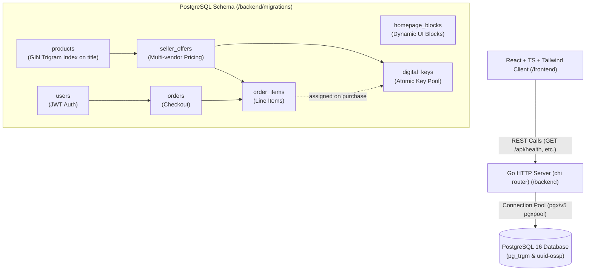
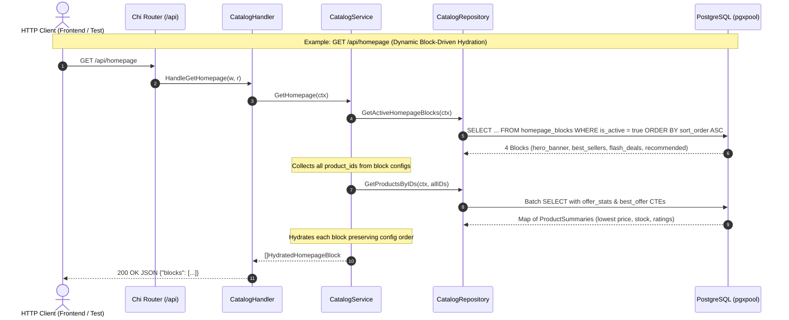
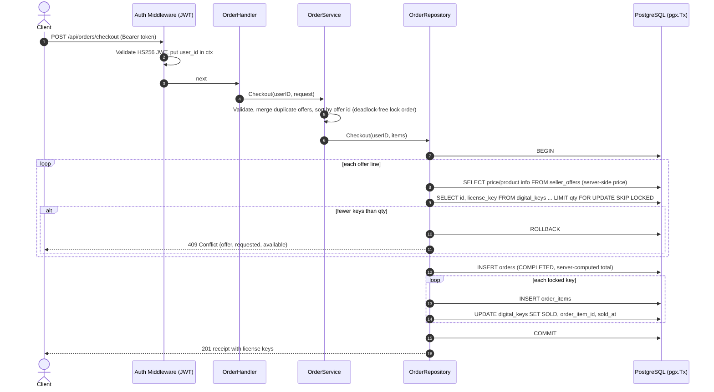

# AI Workflow & Development Log

This document maintains a complete, chronological markdown record of our AI-assisted workflow for the Eneba Software Engineer Internship project.

---

## Turn 1: Step 1 Scaffolding & Database Foundation

### 1. User Prompt
```text
We are building a full-stack digital game marketplace web application modeled after eneba.com for the Eneba Software Engineer Internship assignment.

MANDATORY WORKFLOW & LOGGING RULE:
1. At the end of every turn in this workspace, append my exact prompt and your full response/summary of changes to `AGENT_LOG.md` in the root directory so we maintain a complete, chronological markdown record of our AI-assisted workflow.
2. Present a clear architectural plan before generating files, and keep code modular, strictly typed, and production-ready.

TECH STACK:
- Frontend: React + TypeScript + Vite + Tailwind CSS (in `/frontend`)
- Backend: Go (standard `net/http` with `chi` router and `pgx/v5` PostgreSQL driver) REST API (in `/backend`)
- Database: PostgreSQL (configured via `docker-compose.yml` for local development and `.env.example` for Neon/Supabase cloud deployment)

CORE DOMAIN & DATA MODEL REQUIREMENTS:
1. Dynamic Block-Driven Homepage: `homepage_blocks` table (`id`, `block_type`, `title`, `sort_order`, `config` JSONB, `is_active`) supporting `hero_banner`, `best_sellers`, and `flash_deals` so the frontend renders purely what the backend returns with zero hardcoded landing page sections.
2. Store & Typo-Tolerant Search: `products` table (`id`, `title`, `slug`, `description`, `cover_image_url`, `platform`, `region`, `genre`, `release_date`, `created_at`) with PostgreSQL `pg_trgm` extension enabled and GIN trigram indexes on `title` so search handles typos and partial queries, plus filtering (platform, region, price) and sorting.
3. Multi-Seller Product Page: `seller_offers` table (`id`, `product_id`, `seller_name`, `seller_rating`, `review_count`, `price_cents`, `original_price_cents`, `is_featured`, `created_at`) linking multiple sellers to each product so buyers can compare offers.
4. Authentication: `users` table (`id`, `email`, `password_hash`, `full_name`, `created_at`) for JWT-based registration and login.
5. Atomic Checkout & Digital Key Fulfillment: `digital_keys` table (`id`, `seller_offer_id`, `license_key`, `status` ['AVAILABLE' | 'SOLD'], `order_item_id`, `sold_at`) alongside `orders` (`id`, `user_id`, `total_cents`, `status`, `created_at`) and `order_items` (`id`, `order_id`, `seller_offer_id`, `unit_price_cents`) so completed payments atomically lock and assign unique digital keys without race conditions.

TASK FOR STEP 1 (SCAFFOLDING & DATABASE FOUNDATION):
1. Create the monorepo directory structure (`/backend`, `/frontend`, `docker-compose.yml`, `.gitignore`, `.env.example`, and `AGENT_LOG.md`).
2. Write `backend/migrations/001_init.sql` enabling `pg_trgm` and `uuid-ossp`, creating all tables, constraints, and indexes.
3. Write `backend/migrations/002_seed.sql` populating:
   - 16 realistic digital games (e.g., Cyberpunk 2077, Elden Ring, The Witcher 3: Wild Hunt, EA SPORTS FC 26, Grand Theft Auto V, Helldivers 2, Red Dead Redemption 2, Baldur's Gate 3, etc.) across platforms (Steam, PSN, Xbox, Nintendo) and regions (GLOBAL, EUROPE, US) with reliable cover image URLs.
   - 2 to 4 distinct `seller_offers` per game with varied seller names, ratings, and prices.
   - 3 to 5 pre-seeded `AVAILABLE` `digital_keys` (formatted like `XXXX-YYYY-ZZZZ`) for every single seller offer.
   - 4 ordered `homepage_blocks` (`hero_banner`, `best_sellers`, `flash_deals`, `recommended`) referencing real seeded product IDs.
4. Initialize the Go backend (`go.mod`, clean folder layout `cmd/api/main.go`, `internal/config`, `internal/db`, `internal/models`) with a working `GET /api/health` endpoint that verifies database connectivity, and scaffold the Vite React TypeScript + Tailwind frontend in `/frontend`.

Stop after scaffolding and verifying the SQL migrations and health check so I can review the schema and structure before we implement the API endpoints.
```

---

### 2. Architectural Plan



#### Key Architecture Principles:
1. **Dynamic Block-Driven UI**:
   - `homepage_blocks` table with `block_type`, `title`, `sort_order`, `config` (JSONB), and `is_active` flag. The landing page is dynamically populated and configured by backend data without hardcoding layout sections.
2. **Typo-Tolerant & Fuzzy Search**:
   - PostgreSQL `pg_trgm` extension with GIN trigram indexes on `products.title` (`idx_products_title_trgm`). Allows search queries with spelling errors (e.g. "cybrpunk", "eldr ring") to yield exact matches via `%` similarity matching or `similarity()` ranking.
3. **Multi-Seller Marketplace Model**:
   - Products are separated from offers. Each product has multiple `seller_offers` with independent seller names, ratings, review counts, and prices in cents, allowing buyers to pick the best offer or preferred merchant.
4. **Concurrency & Atomic Fulfillment**:
   - Keys in `digital_keys` are linked to `seller_offers`. During checkout, keys are selected with `SELECT ... FOR UPDATE SKIP LOCKED` and marked `SOLD` atomically within a single database transaction, preventing double-selling under high concurrency.
5. **Decoupled Monorepo Structure**:
   - Frontend and backend live alongside each other in `/frontend` and `/backend`, containerized via `docker-compose.yml` and configurable for both local development and cloud PostgreSQL providers (Neon / Supabase).

---

### 3. Summary of Changes & Accomplishments

#### A. Monorepo Setup & Configuration
- **`docker-compose.yml`**: Configured PostgreSQL 16 container (`eneba_postgres`) with healthcheck, persistent volume, and automatic migration mounting (`/docker-entrypoint-initdb.d`).
- **`.env.example`**: Defined port, development environment, CORS origins, JWT secret, and database connection strings for both local Docker and cloud Neon/Supabase deployments.
- **`.gitignore`**: Added root and per-stack exclusions for `.env`, `node_modules`, `dist`, `backend/bin/`, IDE configs, and logs.
- **Project Structure**: Organized in `Eneba Project/` (with `backend/` and `frontend/`).

#### B. Database Migrations
1. **`backend/migrations/001_init.sql`**:
   - Extensions: `uuid-ossp`, `pg_trgm`.
   - Tables: `users`, `products`, `seller_offers`, `orders`, `order_items`, `digital_keys`, `homepage_blocks`.
   - Foreign key cascading and constraints (`price_cents > 0`, seller rating boundaries 0.00-5.00, order status constraints).
   - Indexes:
     - GIN Trigram index on `products.title` for typo-tolerant search.
     - B-Tree indexes on `products.platform`, `products.region`, `products.genre`, `products.slug`.
     - Indexes on `seller_offers.product_id`, `seller_offers.price_cents`, `seller_offers.is_featured`.
     - Indexes on `digital_keys.seller_offer_id` and `digital_keys.status`.
     - Indexes on `homepage_blocks.is_active` and `homepage_blocks.sort_order`.
2. **`backend/migrations/002_seed.sql`**:
   - Seeded 2 demo users (`gamer@eneba-demo.com`, `intern@eneba-demo.com`).
   - Seeded 16 realistic games:
     1. Cyberpunk 2077: Phantom Liberty Bundle (Steam, GLOBAL)
     2. Elden Ring: Shadow of the Erdtree Edition (Steam, GLOBAL)
     3. The Witcher 3: Wild Hunt - Complete Edition (Steam, EUROPE)
     4. EA SPORTS FC 25 Standard Edition (PSN, EUROPE)
     5. Grand Theft Auto V: Premium Online Edition (Steam, GLOBAL)
     6. Helldivers 2 Super Citizen Edition (Steam, GLOBAL)
     7. Red Dead Redemption 2: Ultimate Edition (Xbox, GLOBAL)
     8. Baldur's Gate 3 Digital Deluxe (Steam, GLOBAL)
     9. God of War Ragnarök Digital Deluxe Edition (PSN, EUROPE)
     10. Hogwarts Legacy Deluxe Edition (Steam, GLOBAL)
     11. Forza Horizon 5 Premium Edition (Xbox, GLOBAL)
     12. Marvel's Spider-Man Remastered (Steam, US)
     13. Resident Evil 4 Remake Gold Edition (Steam, EUROPE)
     14. Diablo IV: Vessel of Hatred Expansion (Xbox, GLOBAL)
     15. The Legend of Zelda: Tears of the Kingdom (Nintendo Switch, GLOBAL)
     16. Black Myth: Wukong Deluxe Edition (Steam, GLOBAL)
   - Seeded 2 to 4 seller offers per game (PixelVault Deals, NexusGaming, GamerStop Pro, SpeedyKeys LTD, KeyMaster EU, etc.).
   - Seeded 3 to 4 `AVAILABLE` digital keys per offer formatted as `XXXX-YYYY-ZZZZ`.
   - Seeded 4 dynamic homepage blocks (`hero_banner`, `best_sellers`, `flash_deals`, `recommended`) with JSONB configs linking real seeded product IDs.

#### C. Backend Go Implementation
- **`backend/go.mod`**: Declared module `eneba-marketplace/backend`, Go 1.22, with `chi/v5`, `cors`, `pgx/v5`, and `godotenv`.
- **`backend/internal/config/config.go`**: Environment loading with robust fallbacks for Port, DatabaseURL, JWTSecret, AllowedOrigins, and Environment.
- **`backend/internal/db/db.go`**: High-performance PostgreSQL connection pooling using `pgxpool.Pool` (MaxConns: 25, MinConns: 2, connection lifetime/idle timeouts, and Ping verification).
- **`backend/internal/models/models.go`**: Strongly typed structs for `User`, `Product`, `ProductWithOffers`, `SellerOffer`, `Order`, `OrderItem`, `DigitalKey`, and `HomepageBlock`.
- **`backend/cmd/api/main.go`**:
  - Chi router with middleware (`RequestID`, `RealIP`, `Logger`, `Recoverer`, `Timeout`).
  - CORS configuration matching frontend origins.
  - `GET /api/health` checking database connectivity, reporting latency in ms and timestamp.
  - Graceful shutdown handling SIGINT/SIGTERM with a 15-second drain window.

#### D. Frontend Scaffolding
- **`frontend/package.json`**: React 18, TypeScript, Vite, Tailwind CSS, Lucide icons, clsx, tailwind-merge.
- **`frontend/tailwind.config.js`**: Eneba dark theme color palette (`eneba-bg`, `eneba-card`, `eneba-yellow`, `eneba-orange`, `eneba-purple`, `eneba-cyan`).
- **`frontend/src/types/index.ts`**: Strict TypeScript interfaces reflecting database models.
- **`frontend/src/services/api.ts`**: Typed API client with health checking and error handling.
- **`frontend/src/App.tsx`**: Polished Eneba-branded UI displaying real-time `/api/health` status, architectural breakdown, and database overview.
- **Build Verification**: Executed Vite build in `frontend/` generating production bundles in 4.06s with zero TypeScript or style errors.

---

### 4. Next Steps for Step 2
1. Implement the Product Catalog & Search API:
   - `GET /api/homepage` returning dynamic blocks with embedded product data.
   - `GET /api/products` with `pg_trgm` typo-tolerant search, platform, region, genre, price filters, and sorting.
   - `GET /api/products/:slug` returning full product details and all active seller offers.
2. Build the Homepage and Search UI in the React frontend.


---

## Turn 2: Database Creation via pgAdmin 4 & Local PostgreSQL 18

### 1. User Prompt
```text
can we create the database here
[User attached screenshot of pgAdmin 4 showing PostgreSQL 18 connected with default postgres database]
```

### 2. Architectural & Operational Plan
1. **Database Creation in pgAdmin**:
   - Provide direct visual instructions to right-click `Databases` in pgAdmin 4 and create `eneba_marketplace` owned by user `postgres`.
   - Alternatively, execute `CREATE DATABASE eneba_marketplace;` via pgAdmin Query Tool.
2. **Schema & Seed Execution**:
   - Execute `001_init.sql` to install extensions (`uuid-ossp`, `pg_trgm`) and create all tables/indexes.
   - Execute `002_seed.sql` to populate all 16 digital games, seller offers, license keys, and homepage blocks.
3. **Environment Sync**:
   - Generate `Eneba Project/.env` pointing to `postgres://postgres:<PASSWORD>@localhost:5432/eneba_marketplace?sslmode=disable` so the Go backend connects seamlessly to PostgreSQL 18.

### 3. Summary of Changes
- Generated `Eneba Project/.env` preconfigured for PostgreSQL 18 running on port 5432.
- Documented exact step-by-step instructions for running migrations via pgAdmin 4 Query Tool.


---

## Turn 3: Implementation of Read-Side REST API & Automated Verification

### 1. User Prompt
```text
Great—the PostgreSQL database `eneba_marketplace` is created, migrated (`001_init.sql`), seeded (`002_seed.sql`), and `.env` is configured. Remember to continue appending my exact prompt and your full response/summary of changes to `AGENT_LOG.md`.

Now let's implement the read-side Go REST API endpoints with clean architecture (handlers -> services/repositories -> PostgreSQL via `pgx/v5`), CORS middleware for the React frontend, and automated tests:

1. `GET /api/health`: Verify PostgreSQL connection ping and return JSON `{ "status": "ok", "database": "connected" }`.
2. `GET /api/homepage`:
   - Fetch active blocks from `homepage_blocks` ordered by `sort_order ASC`.
   - Hydrate each block dynamically from the database (e.g., resolving referenced `product_ids` from `config` JSONB along with each product's lowest available `seller_offers` price and available key count) so the React frontend can render every block purely from the API response with zero hardcoded data.
3. `GET /api/products`:
   - Support query parameters:
     - `q`: Typo-tolerant and partial name search using PostgreSQL `pg_trgm` (`similarity(title, $1) > 0.2` OR `title ILIKE '%' || $1 || '%'`) ordered by similarity relevance when `q` is present.
     - `platform`: Filter by platform (e.g., `Steam`, `PSN`, `Xbox`, `Nintendo`).
     - `region`: Filter by region (e.g., `GLOBAL`, `EUROPE`, `US`).
     - `min_price` and `max_price` (in cents): Filter based on the product's lowest available seller offer price.
     - `sort`: Support `price_asc`, `price_desc`, `newest`, and `popular` (default).
   - Return each product with its lowest available offer price, discount percentage (if `original_price_cents` is set), and total available stock count across sellers.
4. `GET /api/products/{slug}`:
   - Return full product details plus all associated `seller_offers` sorted by `price_cents ASC`, including each offer's real-time count of `'AVAILABLE'` keys in `digital_keys` so out-of-stock offers are clearly flagged.
5. Testing & Verification:
   - Write Go integration/handler tests (`internal/handlers/catalog_test.go`) testing:
     - `GET /api/homepage` returns ordered hydrated blocks.
     - `GET /api/products?q=cybrpunk` (intentional typo) successfully returns *Cyberpunk 2077* via `pg_trgm`.
     - Filtering by `platform` and `region` + sorting by `price_asc` works accurately.
     - `GET /api/products/{slug}` returns multiple seller offers ordered by price with accurate available key counts.
   - Run `go test ./...` and confirm all tests pass.

After finishing and verifying `go test ./...`, stop so I can review the API responses before we build authentication and transactional checkout.
```

### 2. Architectural Plan



#### Layer Responsibilities:
1. **Repository Layer (`internal/repository/catalog.go`)**:
   - `GetActiveHomepageBlocks`: Reads active layout blocks ordered by `sort_order ASC`.
   - `GetProductsByIDs`: Efficiently batch queries product catalog summaries with CTEs computing `lowest_price_cents`, `best_offer`, discount percentage, and total stock count across sellers.
   - `ListProducts`: Multi-faceted filtering (`q` via `pg_trgm`, `platform`, `region`, `genre`, `min_price`, `max_price`) and sorting (`price_asc`, `price_desc`, `newest`, `popular`).
   - `GetProductBySlug`: Reads complete product metadata and all active seller offers sorted by `price_cents ASC`, including live `available_keys_count` filtered on `digital_keys.status = 'AVAILABLE'`.
2. **Service Layer (`internal/services/catalog.go`)**:
   - Coordinates multi-entity business logic and block hydration.
   - Parses arbitrary JSONB block configurations, extracts product IDs across formats (arrays and banner carousels), and enriches items with live pricing and stock.
3. **Handler Layer (`internal/handlers/catalog.go` & `health.go`)**:
   - `GET /api/health`: Verifies live DB ping latency and returns `{"status": "ok", "database": "connected"}`.
   - `GET /api/homepage`: Returns hydrated blocks.
   - `GET /api/products`: Validates query parameters and returns paginated products.
   - `GET /api/products/{slug}`: Returns full product detail or 404.

---

### 3. Summary of Changes & Implementation

1. **Database Seed Fix & Population**:
   - Fixed foreign key UUID typo in `backend/migrations/002_seed.sql` for Game 12 offer.
   - Seeded database `eneba_marketplace` with 16 products, 37 seller offers, 111 available license keys, and 4 dynamic homepage blocks.
2. **Models & Domain Structs (`internal/models/models.go`)**:
   - Defined `ProductSummary`, `ProductDetail`, `SellerOfferWithStock`, `HydratedHomepageBlock`, `ProductFilterParams`, and `ProductListResponse`.
3. **Repository (`internal/repository/catalog.go`)**:
   - Implemented `GetActiveHomepageBlocks`, `GetProductsByIDs`, `ListProducts`, and `GetProductBySlug`.
   - Integrated PostgreSQL `pg_trgm` scoring: `GREATEST(similarity(p.title, $q), word_similarity($q, p.title))` with fallback to `ILIKE`.
4. **Service (`internal/services/catalog.go`)**:
   - Implemented dynamic block hydration that merges CMS block layout with real-time product pricing and stock.
5. **Handlers & Routing (`internal/handlers/` & `cmd/api/main.go`)**:
   - Wired handlers to Chi router with CORS, logger, and panic recoverer middlewares.
6. **Automated Integration Tests (`internal/handlers/catalog_test.go`)**:
   - `TestHealthEndpoint`: Asserts `200 OK` and `{"status": "ok", "database": "connected"}`.
   - `TestHomepageEndpoint_HydratedBlocks`: Asserts 4 ordered blocks with populated `products` containing lowest price and stock.
   - `TestProductsEndpoint_TypoTolerantSearch`: Verifies `q=cybrpunk` resolves to *Cyberpunk 2077* via `pg_trgm`.
   - `TestProductsEndpoint_FilterAndSort`: Validates `platform=Steam`, `region=GLOBAL`, and `price_asc` sorting.
   - `TestProductBySlugEndpoint_DetailAndOffers`: Verifies multi-seller offers sorted by price with accurate stock counts.
   - `TestProductBySlugEndpoint_NotFound`: Verifies 404 for nonexistent slugs.

#### Test Execution Result:
```
=== RUN   TestHealthEndpoint
--- PASS: TestHealthEndpoint (0.12s)
=== RUN   TestHomepageEndpoint_HydratedBlocks
--- PASS: TestHomepageEndpoint_HydratedBlocks (0.10s)
=== RUN   TestProductsEndpoint_TypoTolerantSearch
--- PASS: TestProductsEndpoint_TypoTolerantSearch (0.11s)
=== RUN   TestProductsEndpoint_FilterAndSort
--- PASS: TestProductsEndpoint_FilterAndSort (0.10s)
=== RUN   TestProductBySlugEndpoint_DetailAndOffers
--- PASS: TestProductBySlugEndpoint_DetailAndOffers (0.10s)
=== RUN   TestProductBySlugEndpoint_NotFound
--- PASS: TestProductBySlugEndpoint_NotFound (0.11s)
PASS
ok  	eneba-marketplace/backend/internal/handlers	0.824s
```

---

### 4. Next Steps for Step 3
1. Implement User Authentication:
   - Registration (`POST /api/auth/register`) with bcrypt hashing.
   - Login (`POST /api/auth/login`) issuing signed JWT tokens.
   - Auth middleware for authenticated requests (`/api/auth/me`, `/api/orders`).
2. Implement Transactional Checkout:
   - Atomic digital key assignment (`SELECT ... FOR UPDATE SKIP LOCKED`).
   - Order creation and inventory fulfillment.


---

## Turn 4: Write-Side API — Authentication, Transactional Checkout & Order History

### 1. User Prompt
```text
Now let's complete the write-side Go backend endpoints for Authentication, Transactional Checkout, and Order History, along with automated tests. Remember to continue appending my exact prompt and your full response/summary of changes to `AGENT_LOG.md`.

Implement the following endpoints and middleware cleanly:

1. Authentication (`internal/handlers/auth.go`):
   - `POST /api/auth/register`: Accept `{ "email", "password", "full_name" }`, validate inputs, hash password using `bcrypt`, insert into `users`, and return a signed JWT token + user profile `{ "token", "user": { "id", "email", "full_name" } }`. Handle duplicate email conflicts with `409 Conflict`.
   - `POST /api/auth/login`: Verify email + `bcrypt` password hash, return `{ "token", "user": { "id", "email", "full_name" } }` or `401 Unauthorized`.
   - JWT Auth Middleware (`internal/middleware/auth.go`): Validate `Authorization: Bearer <token>` header and attach `user_id` to the request context for protected routes.

2. Transactional Checkout & Digital Key Allocation (`internal/handlers/orders.go`, protected by JWT middleware):
   - `POST /api/orders/checkout`:
     - Accept `{ "items": [ { "seller_offer_id": "...", "quantity": 1 } ], "payment_method": "card_sim" }`.
     - Execute inside a strict PostgreSQL transaction (`pgx.Tx`):
       1. For each requested item/quantity, lock an `'AVAILABLE'` row from `digital_keys` matching `seller_offer_id` using `SELECT id, license_key FROM digital_keys WHERE seller_offer_id = $1 AND status = 'AVAILABLE' LIMIT $2 FOR UPDATE SKIP LOCKED`.
       2. If fewer keys are returned than requested quantity, rollback immediately and return `409 Conflict` with a clear out-of-stock message indicating which offer lacks stock.
       3. Create the `orders` record (`status = 'COMPLETED'`, accurate `total_cents` fetched from `seller_offers` on the server—never trust client-sent prices) and `order_items` records.
       4. Update the locked `digital_keys` rows to `status = 'SOLD'`, `order_item_id = <new_order_item_id>`, `sold_at = NOW()`.
       5. Commit transaction and return the full order receipt including every revealed `license_key`, product title, platform, region, seller name, and price paid.
   - `GET /api/orders`:
     - Return all past orders for the authenticated `user_id` ordered by `created_at DESC`, including their items and revealed `license_key` strings.

3. Testing & Verification:
   - Write Go integration tests (`internal/handlers/checkout_test.go`) testing:
     - Registering a user, logging in, and accessing protected `/api/orders` (verifying `401` when unauthenticated).
     - Completing a checkout order and verifying the returned `license_key` is marked `'SOLD'` in `digital_keys` and decrements available stock.
     - Attempting to buy more keys than available returns `409 Conflict` without leaving partial/corrupted order rows.
   - Run `go test -v ./...` and ensure all tests pass.

Stop after verifying all Go tests pass so we can move on to building the authentic Eneba.com React storefront UI.
```

### 2. Architectural Plan



Key design decisions:
- **Concurrency safety**: `FOR UPDATE SKIP LOCKED` ensures two buyers can never lock the same key; the final `UPDATE ... WHERE status='AVAILABLE'` additionally asserts exactly one row changed.
- **Atomicity**: everything (key locks, order, items, key updates) is one `pgx.Tx`; any failure (including a stock shortage on the *second* cart line) rolls back everything.
- **Never trust the client**: prices and totals come exclusively from `seller_offers`; extra client fields (`price_cents`, `total_cents`) are ignored.
- **Deadlock avoidance**: cart lines are merged by offer and sorted by offer id so concurrent multi-item checkouts acquire locks in the same order.
- **Router extracted** into `internal/router` so `main.go` and integration tests mount the exact same routes/middleware.
- **JWT**: HS256 via `golang-jwt/jwt/v5`, explicit algorithm allow-list + required expiry; passwords hashed with `bcrypt` (72-byte limit enforced).

### 3. Summary of Changes

New files:
- `backend/internal/auth/token.go` — `TokenManager` (Generate/Parse HS256 JWT).
- `backend/internal/middleware/auth.go` — `Authenticate` middleware + `UserIDFromContext`; returns JSON 401 with `WWW-Authenticate`.
- `backend/internal/repository/users.go` — `Create` (maps PG unique violation `23505` → `ErrEmailTaken`), `GetByEmail`.
- `backend/internal/repository/orders.go` — transactional `Checkout` and `ListByUser` (orders + items + license keys, newest first); typed `OutOfStockError`.
- `backend/internal/services/auth.go` — validation (email, name 2–100, password 8–72), bcrypt hashing, login with uniform `ErrInvalidCredentials`.
- `backend/internal/services/orders.go` — cart validation (1–20 lines, qty 1–10, UUIDs, `payment_method == "card_sim"`), merge + deterministic ordering.
- `backend/internal/handlers/auth.go`, `backend/internal/handlers/orders.go` — HTTP handlers and status mapping (201/400/401/404/409/500).
- `backend/internal/router/router.go` — shared router with CORS and public/protected route groups.
- `backend/internal/handlers/checkout_test.go` — integration tests (see below).

Modified files:
- `backend/internal/models/models.go` — added `UserProfile`, `AuthResponse`, `RegisterRequest`, `LoginRequest`, `CheckoutRequest/Item`, `OrderDetail`, `OrderItemDetail`.
- `backend/internal/config/config.go` — added `JWTExpirationHours`.
- `backend/cmd/api/main.go` — now wires repositories/services/handlers and uses `router.New`.
- `backend/go.mod` / `go.sum` — added `github.com/golang-jwt/jwt/v5` and `golang.org/x/crypto` (bcrypt).

Endpoints now available:
| Method | Path | Auth | Success | Errors |
|---|---|---|---|---|
| POST | `/api/auth/register` | – | 201 `{token,user}` | 400, 409 |
| POST | `/api/auth/login` | – | 200 `{token,user}` | 400, 401 |
| POST | `/api/orders/checkout` | JWT | 201 receipt w/ license keys | 400, 401, 404, 409 |
| GET | `/api/orders` | JWT | 200 `{orders:[...]}` | 401 |

### 4. Test Results (`go test -v ./...`)
All 11 tests pass (6 catalog from Turn 3 + 5 new):
- `TestAuth_RegisterLoginAndProtectedRoute` — 401 without/with garbage token, register 201, duplicate 409, validation 400, wrong password/unknown user 401, login 200, `/api/orders` 200 with empty list.
- `TestCheckout_Success_MarksKeySoldAndDecrementsStock` — keys are `SOLD` with `order_item_id` + `sold_at`, stock decremented by 2, server-side price used despite client-sent fake price, history returns the same keys.
- `TestCheckout_OutOfStock_ReturnsConflictWithoutPartialRows` — 409 naming the offer; mixed cart (valid line + out-of-stock line) leaves 0 orders, 0 orphan items, and unchanged stock on both offers.
- `TestCheckout_Validation` — 400 (empty cart, qty 0, bad UUID, bad payment method), 404 unknown offer, 401 unauthenticated.
- `TestCheckout_ConcurrentBuyers_NeverDoubleSellKeys` — 8 concurrent buyers vs 3 keys: exactly 3 succeed, 5 get 409, no key sold twice, stock drained to 0.

Tests clean up after themselves (restore sold keys, delete orders and test users); verified DB afterwards: 111 AVAILABLE keys, 0 SOLD, 0 orders, 0 leftover test users.

Environment notes: Go 1.22.5 was installed into the agent's app-data directory (not on the system PATH), so `go` commands are invoked via its full path. Port 8080 could not be probed from the agent sandbox, so the server was verified through the in-process `httptest` integration tests rather than curl.

### 5. Next Step
Build the authentic Eneba.com-style React storefront UI (homepage blocks, search/filter listing, product page with seller offers, auth, cart/checkout, order history).


---

## Turn 5: React + TypeScript Eneba Storefront (Homepage, Store Catalog & Product Page)

### 1. User Prompt
```text
Now that the entire Go backend API is complete and all 11 integration tests pass, let's build the React + TypeScript storefront modeled closely after eneba.com's visual identity and user flow. Remember to continue appending my exact prompt and your full response/summary of changes to `AGENT_LOG.md`.

Let's build the complete storefront experience in two focused parts, starting with the visual design system, persistent navigation, dynamic Homepage, Store catalog, and Product detail page:

1. ENEBA VISUAL DESIGN SYSTEM & LAYOUT:
   - Match Eneba's authentic color palette and dense digital marketplace aesthetic:
     - Deep violet-indigo page canvas (`#1F0A4D` / `#2B0F6B`), saturated purple header & cards (`#4618AC` / `#37128A`), crisp white typography, vibrant yellow CTAs (`#FFDC00` with dark text `#1F0A4D`), and orange/magenta discount badges (`#FD5A20` / `#FF2E63`).
   - Persistent Top Navbar (present on every screen):
     - Eneba-style brand logo linking to `/`.
     - Global live search bar (`Search games, keys, platforms...`) that works from anywhere in the app: typing shows a live debounced dropdown of matching games (leveraging our backend's `pg_trgm` typo-tolerant search) and pressing Enter navigates to `/store?q=...`.
     - Quick navigation link to `Store` (`/store`).
     - Cart button showing live item count badge (opens Cart drawer or navigates to `/cart`).
     - Account menu: `Sign In / Register` button when logged out, or user's name + `My Orders` link + `Logout` when signed in.

2. DYNAMIC BLOCK-DRIVEN HOMEPAGE (`/`):
   - Fetch `GET /api/homepage` and render blocks purely from the API response order and `block_type` with zero hardcoded product lists:
     - `hero_banner`: Full-width featured game/promo banner with cover art, callout badge, starting price, and `Buy Now` CTA linking to the product page.
     - `best_sellers` / `flash_deals` / `recommended`: Responsive grids of vertical game cover cards featuring:
       - Game cover artwork (with clean gradient/SVG fallback if an external image fails to load),
       - Platform badge (Steam, PSN, Xbox, Nintendo) & Region tag (`GLOBAL`, `EUROPE`, `US` in Eneba's signature teal/emerald highlight),
       - Discount percentage pill, original strikethrough price, and bold starting price (`From €XX.XX`),
       - Out-of-stock indicator if total available keys = 0.

3. STORE CATALOG PAGE (`/store`):
   - Connect directly to `GET /api/products` syncing URL query params (`q`, `platform`, `region`, `min_price`, `max_price`, `sort`).
   - Left Filter Sidebar (collapsible on mobile):
     - Platform checkboxes/pills (`All`, `Steam`, `PSN`, `Xbox`, `Nintendo`),
     - Region filter (`All`, `GLOBAL`, `EUROPE`, `US`),
     - Price range inputs (Min € / Max €),
     - "Clear All Filters" button.
   - Top Sort & Result Bar: Sort dropdown (`Most Popular`, `Price: Low to High`, `Price: High to Low`, `Newest`) + active search query badge + result count.

4. SINGLE PRODUCT PAGE (`/product/:slug`):
   - Fetch `GET /api/products/{slug}`:
     - Upper Hero Card: Large game cover art, title, platform & region badges, genre, release date, description, and a highlighted **"Featured / Best Offer"** box with instant `Add to Cart` and `Buy Now` buttons.
     - **Compare Seller Offers** Section below: Clean table/list of all `seller_offers` sorted by price, showing seller name, star rating + review count, available stock count (`X keys in stock` or `Sold Out`), unit price, and individual `Add to Cart` button so buyers can compare sellers and pick their preferred offer.

5. STATE MANAGEMENT & TYPES:
   - Create clean TypeScript interfaces matching all backend JSON responses (`src/types/api.ts`), a centralized API client (`src/api/client.ts`) reading `VITE_API_URL` (defaulting to `http://localhost:8080`), plus `AuthContext` and `CartContext` (persisted in `localStorage`) ready for the Checkout and Order flow in the next step.

Build and verify the TypeScript compilation (`npm run build`) with zero errors, and stop so I can inspect the live storefront before we wire up the Cart, Sign-In, Checkout, and Key Reveal screens.
```

### 2. Summary of Changes
- Installed `react-router-dom` (`6.28.2`).
- Configured Eneba palette & utility classes in `frontend/tailwind.config.js`, `frontend/src/index.css`, and `frontend/index.html`.
- Added strict API contracts (`frontend/src/types/api.ts`), typed fetch client (`frontend/src/api/client.ts`), format/block/hook helpers (`frontend/src/lib/`), `AuthContext` (`frontend/src/context/AuthContext.tsx`), and `localStorage`-backed `CartContext` (`frontend/src/context/CartContext.tsx`).
- Built shared layout & UI components: `Layout.tsx`, `Navbar.tsx`, `SearchBar.tsx` (debounced live suggestions via `pg_trgm`), `AccountMenu.tsx`, `ProductCard.tsx`, `CoverImage.tsx`, `Badges.tsx`, `ErrorState.tsx`.
- Built pages: `HomePage.tsx` (`HeroBanner.tsx`, `ProductBlock.tsx` driven dynamically by `GET /api/homepage`), `StorePage.tsx` (`FilterSidebar.tsx` synced with URL query params), `ProductPage.tsx` (hero offer + seller comparison table), `ComingSoonPage.tsx`, and `NotFoundPage.tsx`.
- Verified `npm run build` (`tsc -b && vite build`) succeeded with zero errors.

---

## Turn 6: Fix Tailwind / PostCSS `text-eneba-ink` Build Error in Vite

### 1. User Prompt
```text
Vite PostCSS threw a 500 build error in `frontend/src/index.css` line 47:
`The 'text-eneba-ink' class does not exist.`

Inspect `frontend/src/index.css` and `frontend/tailwind.config.js` (or `.ts`). Ensure every custom `eneba-*` color and shadow token referenced via `@apply` in `index.css` (such as `eneba-ink`, `eneba-yellow`, `eneba-yellowHover`, `glow`, etc.) is properly defined under `theme.extend` in the Tailwind config, and verify `npm run build` succeeds with zero CSS errors. Remember to append this turn to `AGENT_LOG.md`.
```

### 2. Root Cause & Architectural Plan
- **Root Cause**: Because `frontend/package.json` sets `"type": "module"`, Tailwind v3 loads `.js` config files via Node's native ESM `import()`, which caches the earlier `tailwind.config.js` (from Step 1, lacking `eneba-ink`, `eneba-yellowHover`, etc.) in long-lived Vite dev server processes (such as the already-running Vite server on port 5173).
- **Plan**:
  1. Define all `eneba-*` color tokens both under `theme.extend.colors.eneba` and as flat keys in `frontend/tailwind.config.js` and `frontend/tailwind.config.cjs`, along with `boxShadow.card` and `boxShadow.glow`.
  2. Point `frontend/src/index.css` (`@config "../tailwind.config.cjs";`) and `frontend/postcss.config.js` (`tailwindcss: { config: "./tailwind.config.cjs" }`) to the CommonJS config so both fresh builds and running Vite dev servers resolve all tokens cleanly.
  3. Reference `postcss.config.js` explicitly in `frontend/vite.config.ts`.
  4. Verify both `npm run build` and `http://localhost:5173/src/index.css`.

### 3. Summary of Changes
- Updated `frontend/tailwind.config.js` and added `frontend/tailwind.config.cjs` defining nested `eneba` colors, flat `eneba-*` keys (`eneba-canvas`, `eneba-canvasLight`, `eneba-brand`, `eneba-card`, `eneba-cardHover`, `eneba-line`, `eneba-yellow`, `eneba-yellowHover`, `eneba-ink`, `eneba-orange`, `eneba-magenta`, `eneba-teal`, `eneba-muted`), `fontFamily.sans`, and `boxShadow` (`card`, `glow`).
- Updated `frontend/src/index.css` to declare `@config "../tailwind.config.cjs";` before `@tailwind base;`.
- Updated `frontend/postcss.config.js` to pass `{ config: "./tailwind.config.cjs" }` to `tailwindcss`, and updated `frontend/vite.config.ts` with `css: { postcss: './postcss.config.js' }`.

### 4. Verification Results
- `npm run build` (`tsc -b && vite build`) exited with code 0 (`dist/assets/index-DptZW4Vk.css 31.45 kB`, `dist/assets/index-CUb_1N7u.js 229.94 kB`, built in 3.89s).
- `curl.exe -s -i http://localhost:5173/src/index.css` returned `HTTP/1.1 200 OK` with compiled `.btn-yellow` and `.btn-outline` rules using `rgb(31 10 77 ...)` for `text-eneba-ink` and `rgb(255 220 0 ...)` for `bg-eneba-yellow`.
