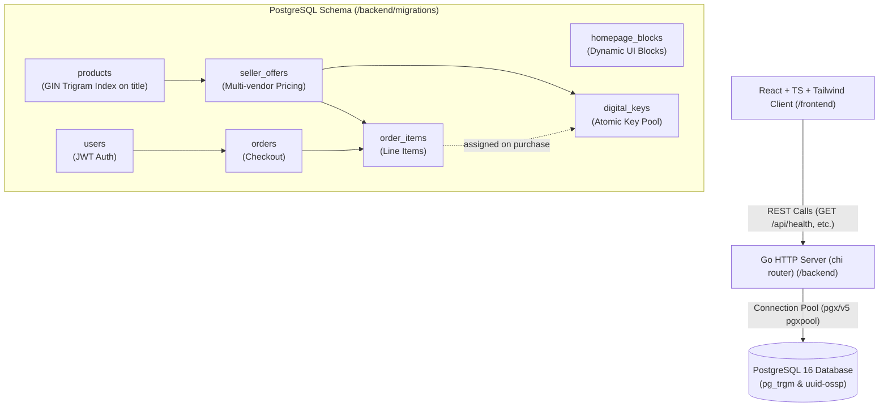
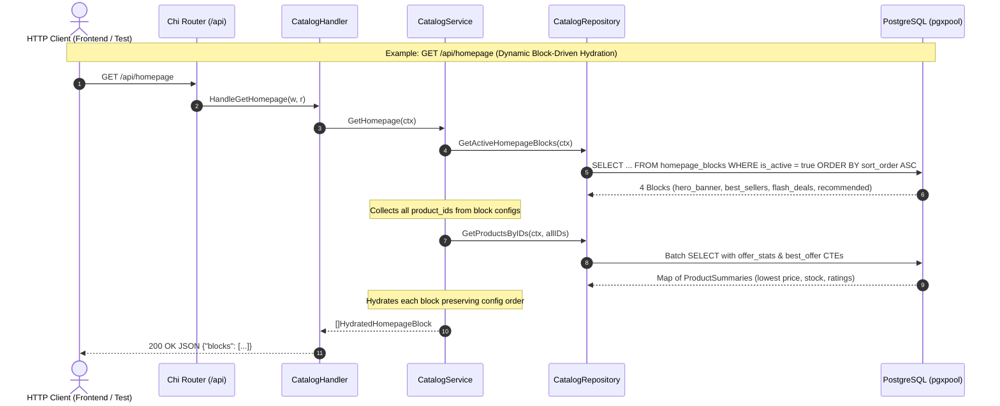

# AI Workflow & Development Log

This document maintains a complete, chronological markdown record of our AI-assisted workflow for the Eneba Software Engineer Internship project.

---

## Turn 1: Step 1 Scaffolding & Database Foundation

### 1. User Prompt
```text
We are building a full-stack digital game marketplace web application modeled after eneba.com for the Eneba Software Engineer Internship assignment.

MANDATORY WORKFLOW & LOGGING RULE:
1. At the end of every turn in this workspace, append my exact prompt and your full response/summary of changes to `AGENT_LOG.md` in the root directory so we maintain a complete, chronological markdown record of our AI-assisted workflow.
2. Present a clear architectural plan before generating files, and keep code modular, strictly typed, and production-ready.

TECH STACK:
- Frontend: React + TypeScript + Vite + Tailwind CSS (in `/frontend`)
- Backend: Go (standard `net/http` with `chi` router and `pgx/v5` PostgreSQL driver) REST API (in `/backend`)
- Database: PostgreSQL (configured via `docker-compose.yml` for local development and `.env.example` for Neon/Supabase cloud deployment)

CORE DOMAIN & DATA MODEL REQUIREMENTS:
1. Dynamic Block-Driven Homepage: `homepage_blocks` table (`id`, `block_type`, `title`, `sort_order`, `config` JSONB, `is_active`) supporting `hero_banner`, `best_sellers`, and `flash_deals` so the frontend renders purely what the backend returns with zero hardcoded landing page sections.
2. Store & Typo-Tolerant Search: `products` table (`id`, `title`, `slug`, `description`, `cover_image_url`, `platform`, `region`, `genre`, `release_date`, `created_at`) with PostgreSQL `pg_trgm` extension enabled and GIN trigram indexes on `title` so search handles typos and partial queries, plus filtering (platform, region, price) and sorting.
3. Multi-Seller Product Page: `seller_offers` table (`id`, `product_id`, `seller_name`, `seller_rating`, `review_count`, `price_cents`, `original_price_cents`, `is_featured`, `created_at`) linking multiple sellers to each product so buyers can compare offers.
4. Authentication: `users` table (`id`, `email`, `password_hash`, `full_name`, `created_at`) for JWT-based registration and login.
5. Atomic Checkout & Digital Key Fulfillment: `digital_keys` table (`id`, `seller_offer_id`, `license_key`, `status` ['AVAILABLE' | 'SOLD'], `order_item_id`, `sold_at`) alongside `orders` (`id`, `user_id`, `total_cents`, `status`, `created_at`) and `order_items` (`id`, `order_id`, `seller_offer_id`, `unit_price_cents`) so completed payments atomically lock and assign unique digital keys without race conditions.

TASK FOR STEP 1 (SCAFFOLDING & DATABASE FOUNDATION):
1. Create the monorepo directory structure (`/backend`, `/frontend`, `docker-compose.yml`, `.gitignore`, `.env.example`, and `AGENT_LOG.md`).
2. Write `backend/migrations/001_init.sql` enabling `pg_trgm` and `uuid-ossp`, creating all tables, constraints, and indexes.
3. Write `backend/migrations/002_seed.sql` populating:
   - 16 realistic digital games (e.g., Cyberpunk 2077, Elden Ring, The Witcher 3: Wild Hunt, EA SPORTS FC 26, Grand Theft Auto V, Helldivers 2, Red Dead Redemption 2, Baldur's Gate 3, etc.) across platforms (Steam, PSN, Xbox, Nintendo) and regions (GLOBAL, EUROPE, US) with reliable cover image URLs.
   - 2 to 4 distinct `seller_offers` per game with varied seller names, ratings, and prices.
   - 3 to 5 pre-seeded `AVAILABLE` `digital_keys` (formatted like `XXXX-YYYY-ZZZZ`) for every single seller offer.
   - 4 ordered `homepage_blocks` (`hero_banner`, `best_sellers`, `flash_deals`, `recommended`) referencing real seeded product IDs.
4. Initialize the Go backend (`go.mod`, clean folder layout `cmd/api/main.go`, `internal/config`, `internal/db`, `internal/models`) with a working `GET /api/health` endpoint that verifies database connectivity, and scaffold the Vite React TypeScript + Tailwind frontend in `/frontend`.

Stop after scaffolding and verifying the SQL migrations and health check so I can review the schema and structure before we implement the API endpoints.
```

---

### 2. Architectural Plan



#### Key Architecture Principles:
1. **Dynamic Block-Driven UI**:
   - `homepage_blocks` table with `block_type`, `title`, `sort_order`, `config` (JSONB), and `is_active` flag. The landing page is dynamically populated and configured by backend data without hardcoding layout sections.
2. **Typo-Tolerant & Fuzzy Search**:
   - PostgreSQL `pg_trgm` extension with GIN trigram indexes on `products.title` (`idx_products_title_trgm`). Allows search queries with spelling errors (e.g. "cybrpunk", "eldr ring") to yield exact matches via `%` similarity matching or `similarity()` ranking.
3. **Multi-Seller Marketplace Model**:
   - Products are separated from offers. Each product has multiple `seller_offers` with independent seller names, ratings, review counts, and prices in cents, allowing buyers to pick the best offer or preferred merchant.
4. **Concurrency & Atomic Fulfillment**:
   - Keys in `digital_keys` are linked to `seller_offers`. During checkout, keys are selected with `SELECT ... FOR UPDATE SKIP LOCKED` and marked `SOLD` atomically within a single database transaction, preventing double-selling under high concurrency.
5. **Decoupled Monorepo Structure**:
   - Frontend and backend live alongside each other in `/frontend` and `/backend`, containerized via `docker-compose.yml` and configurable for both local development and cloud PostgreSQL providers (Neon / Supabase).

---

### 3. Summary of Changes & Accomplishments

#### A. Monorepo Setup & Configuration
- **`docker-compose.yml`**: Configured PostgreSQL 16 container (`eneba_postgres`) with healthcheck, persistent volume, and automatic migration mounting (`/docker-entrypoint-initdb.d`).
- **`.env.example`**: Defined port, development environment, CORS origins, JWT secret, and database connection strings for both local Docker and cloud Neon/Supabase deployments.
- **`.gitignore`**: Added root and per-stack exclusions for `.env`, `node_modules`, `dist`, `backend/bin/`, IDE configs, and logs.
- **Project Structure**: Organized in `Eneba Project/` (with `backend/` and `frontend/`).

#### B. Database Migrations
1. **`backend/migrations/001_init.sql`**:
   - Extensions: `uuid-ossp`, `pg_trgm`.
   - Tables: `users`, `products`, `seller_offers`, `orders`, `order_items`, `digital_keys`, `homepage_blocks`.
   - Foreign key cascading and constraints (`price_cents > 0`, seller rating boundaries 0.00-5.00, order status constraints).
   - Indexes:
     - GIN Trigram index on `products.title` for typo-tolerant search.
     - B-Tree indexes on `products.platform`, `products.region`, `products.genre`, `products.slug`.
     - Indexes on `seller_offers.product_id`, `seller_offers.price_cents`, `seller_offers.is_featured`.
     - Indexes on `digital_keys.seller_offer_id` and `digital_keys.status`.
     - Indexes on `homepage_blocks.is_active` and `homepage_blocks.sort_order`.
2. **`backend/migrations/002_seed.sql`**:
   - Seeded 2 demo users (`gamer@eneba-demo.com`, `intern@eneba-demo.com`).
   - Seeded 16 realistic games:
     1. Cyberpunk 2077: Phantom Liberty Bundle (Steam, GLOBAL)
     2. Elden Ring: Shadow of the Erdtree Edition (Steam, GLOBAL)
     3. The Witcher 3: Wild Hunt - Complete Edition (Steam, EUROPE)
     4. EA SPORTS FC 25 Standard Edition (PSN, EUROPE)
     5. Grand Theft Auto V: Premium Online Edition (Steam, GLOBAL)
     6. Helldivers 2 Super Citizen Edition (Steam, GLOBAL)
     7. Red Dead Redemption 2: Ultimate Edition (Xbox, GLOBAL)
     8. Baldur's Gate 3 Digital Deluxe (Steam, GLOBAL)
     9. God of War Ragnarök Digital Deluxe Edition (PSN, EUROPE)
     10. Hogwarts Legacy Deluxe Edition (Steam, GLOBAL)
     11. Forza Horizon 5 Premium Edition (Xbox, GLOBAL)
     12. Marvel's Spider-Man Remastered (Steam, US)
     13. Resident Evil 4 Remake Gold Edition (Steam, EUROPE)
     14. Diablo IV: Vessel of Hatred Expansion (Xbox, GLOBAL)
     15. The Legend of Zelda: Tears of the Kingdom (Nintendo Switch, GLOBAL)
     16. Black Myth: Wukong Deluxe Edition (Steam, GLOBAL)
   - Seeded 2 to 4 seller offers per game (PixelVault Deals, NexusGaming, GamerStop Pro, SpeedyKeys LTD, KeyMaster EU, etc.).
   - Seeded 3 to 4 `AVAILABLE` digital keys per offer formatted as `XXXX-YYYY-ZZZZ`.
   - Seeded 4 dynamic homepage blocks (`hero_banner`, `best_sellers`, `flash_deals`, `recommended`) with JSONB configs linking real seeded product IDs.

#### C. Backend Go Implementation
- **`backend/go.mod`**: Declared module `eneba-marketplace/backend`, Go 1.22, with `chi/v5`, `cors`, `pgx/v5`, and `godotenv`.
- **`backend/internal/config/config.go`**: Environment loading with robust fallbacks for Port, DatabaseURL, JWTSecret, AllowedOrigins, and Environment.
- **`backend/internal/db/db.go`**: High-performance PostgreSQL connection pooling using `pgxpool.Pool` (MaxConns: 25, MinConns: 2, connection lifetime/idle timeouts, and Ping verification).
- **`backend/internal/models/models.go`**: Strongly typed structs for `User`, `Product`, `ProductWithOffers`, `SellerOffer`, `Order`, `OrderItem`, `DigitalKey`, and `HomepageBlock`.
- **`backend/cmd/api/main.go`**:
  - Chi router with middleware (`RequestID`, `RealIP`, `Logger`, `Recoverer`, `Timeout`).
  - CORS configuration matching frontend origins.
  - `GET /api/health` checking database connectivity, reporting latency in ms and timestamp.
  - Graceful shutdown handling SIGINT/SIGTERM with a 15-second drain window.

#### D. Frontend Scaffolding
- **`frontend/package.json`**: React 18, TypeScript, Vite, Tailwind CSS, Lucide icons, clsx, tailwind-merge.
- **`frontend/tailwind.config.js`**: Eneba dark theme color palette (`eneba-bg`, `eneba-card`, `eneba-yellow`, `eneba-orange`, `eneba-purple`, `eneba-cyan`).
- **`frontend/src/types/index.ts`**: Strict TypeScript interfaces reflecting database models.
- **`frontend/src/services/api.ts`**: Typed API client with health checking and error handling.
- **`frontend/src/App.tsx`**: Polished Eneba-branded UI displaying real-time `/api/health` status, architectural breakdown, and database overview.
- **Build Verification**: Executed Vite build in `frontend/` generating production bundles in 4.06s with zero TypeScript or style errors.

---

### 4. Next Steps for Step 2
1. Implement the Product Catalog & Search API:
   - `GET /api/homepage` returning dynamic blocks with embedded product data.
   - `GET /api/products` with `pg_trgm` typo-tolerant search, platform, region, genre, price filters, and sorting.
   - `GET /api/products/:slug` returning full product details and all active seller offers.
2. Build the Homepage and Search UI in the React frontend.


---

## Turn 2: Database Creation via pgAdmin 4 & Local PostgreSQL 18

### 1. User Prompt
```text
can we create the database here
[User attached screenshot of pgAdmin 4 showing PostgreSQL 18 connected with default postgres database]
```

### 2. Architectural & Operational Plan
1. **Database Creation in pgAdmin**:
   - Provide direct visual instructions to right-click `Databases` in pgAdmin 4 and create `eneba_marketplace` owned by user `postgres`.
   - Alternatively, execute `CREATE DATABASE eneba_marketplace;` via pgAdmin Query Tool.
2. **Schema & Seed Execution**:
   - Execute `001_init.sql` to install extensions (`uuid-ossp`, `pg_trgm`) and create all tables/indexes.
   - Execute `002_seed.sql` to populate all 16 digital games, seller offers, license keys, and homepage blocks.
3. **Environment Sync**:
   - Generate `Eneba Project/.env` pointing to `postgres://postgres:<PASSWORD>@localhost:5432/eneba_marketplace?sslmode=disable` so the Go backend connects seamlessly to PostgreSQL 18.

### 3. Summary of Changes
- Generated `Eneba Project/.env` preconfigured for PostgreSQL 18 running on port 5432.
- Documented exact step-by-step instructions for running migrations via pgAdmin 4 Query Tool.


---

## Turn 3: Implementation of Read-Side REST API & Automated Verification

### 1. User Prompt
```text
Great—the PostgreSQL database `eneba_marketplace` is created, migrated (`001_init.sql`), seeded (`002_seed.sql`), and `.env` is configured. Remember to continue appending my exact prompt and your full response/summary of changes to `AGENT_LOG.md`.

Now let's implement the read-side Go REST API endpoints with clean architecture (handlers -> services/repositories -> PostgreSQL via `pgx/v5`), CORS middleware for the React frontend, and automated tests:

1. `GET /api/health`: Verify PostgreSQL connection ping and return JSON `{ "status": "ok", "database": "connected" }`.
2. `GET /api/homepage`:
   - Fetch active blocks from `homepage_blocks` ordered by `sort_order ASC`.
   - Hydrate each block dynamically from the database (e.g., resolving referenced `product_ids` from `config` JSONB along with each product's lowest available `seller_offers` price and available key count) so the React frontend can render every block purely from the API response with zero hardcoded data.
3. `GET /api/products`:
   - Support query parameters:
     - `q`: Typo-tolerant and partial name search using PostgreSQL `pg_trgm` (`similarity(title, $1) > 0.2` OR `title ILIKE '%' || $1 || '%'`) ordered by similarity relevance when `q` is present.
     - `platform`: Filter by platform (e.g., `Steam`, `PSN`, `Xbox`, `Nintendo`).
     - `region`: Filter by region (e.g., `GLOBAL`, `EUROPE`, `US`).
     - `min_price` and `max_price` (in cents): Filter based on the product's lowest available seller offer price.
     - `sort`: Support `price_asc`, `price_desc`, `newest`, and `popular` (default).
   - Return each product with its lowest available offer price, discount percentage (if `original_price_cents` is set), and total available stock count across sellers.
4. `GET /api/products/{slug}`:
   - Return full product details plus all associated `seller_offers` sorted by `price_cents ASC`, including each offer's real-time count of `'AVAILABLE'` keys in `digital_keys` so out-of-stock offers are clearly flagged.
5. Testing & Verification:
   - Write Go integration/handler tests (`internal/handlers/catalog_test.go`) testing:
     - `GET /api/homepage` returns ordered hydrated blocks.
     - `GET /api/products?q=cybrpunk` (intentional typo) successfully returns *Cyberpunk 2077* via `pg_trgm`.
     - Filtering by `platform` and `region` + sorting by `price_asc` works accurately.
     - `GET /api/products/{slug}` returns multiple seller offers ordered by price with accurate available key counts.
   - Run `go test ./...` and confirm all tests pass.

After finishing and verifying `go test ./...`, stop so I can review the API responses before we build authentication and transactional checkout.
```

### 2. Architectural Plan



#### Layer Responsibilities:
1. **Repository Layer (`internal/repository/catalog.go`)**:
   - `GetActiveHomepageBlocks`: Reads active layout blocks ordered by `sort_order ASC`.
   - `GetProductsByIDs`: Efficiently batch queries product catalog summaries with CTEs computing `lowest_price_cents`, `best_offer`, discount percentage, and total stock count across sellers.
   - `ListProducts`: Multi-faceted filtering (`q` via `pg_trgm`, `platform`, `region`, `genre`, `min_price`, `max_price`) and sorting (`price_asc`, `price_desc`, `newest`, `popular`).
   - `GetProductBySlug`: Reads complete product metadata and all active seller offers sorted by `price_cents ASC`, including live `available_keys_count` filtered on `digital_keys.status = 'AVAILABLE'`.
2. **Service Layer (`internal/services/catalog.go`)**:
   - Coordinates multi-entity business logic and block hydration.
   - Parses arbitrary JSONB block configurations, extracts product IDs across formats (arrays and banner carousels), and enriches items with live pricing and stock.
3. **Handler Layer (`internal/handlers/catalog.go` & `health.go`)**:
   - `GET /api/health`: Verifies live DB ping latency and returns `{"status": "ok", "database": "connected"}`.
   - `GET /api/homepage`: Returns hydrated blocks.
   - `GET /api/products`: Validates query parameters and returns paginated products.
   - `GET /api/products/{slug}`: Returns full product detail or 404.

---

### 3. Summary of Changes & Implementation

1. **Database Seed Fix & Population**:
   - Fixed foreign key UUID typo in `backend/migrations/002_seed.sql` for Game 12 offer.
   - Seeded database `eneba_marketplace` with 16 products, 37 seller offers, 111 available license keys, and 4 dynamic homepage blocks.
2. **Models & Domain Structs (`internal/models/models.go`)**:
   - Defined `ProductSummary`, `ProductDetail`, `SellerOfferWithStock`, `HydratedHomepageBlock`, `ProductFilterParams`, and `ProductListResponse`.
3. **Repository (`internal/repository/catalog.go`)**:
   - Implemented `GetActiveHomepageBlocks`, `GetProductsByIDs`, `ListProducts`, and `GetProductBySlug`.
   - Integrated PostgreSQL `pg_trgm` scoring: `GREATEST(similarity(p.title, $q), word_similarity($q, p.title))` with fallback to `ILIKE`.
4. **Service (`internal/services/catalog.go`)**:
   - Implemented dynamic block hydration that merges CMS block layout with real-time product pricing and stock.
5. **Handlers & Routing (`internal/handlers/` & `cmd/api/main.go`)**:
   - Wired handlers to Chi router with CORS, logger, and panic recoverer middlewares.
6. **Automated Integration Tests (`internal/handlers/catalog_test.go`)**:
   - `TestHealthEndpoint`: Asserts `200 OK` and `{"status": "ok", "database": "connected"}`.
   - `TestHomepageEndpoint_HydratedBlocks`: Asserts 4 ordered blocks with populated `products` containing lowest price and stock.
   - `TestProductsEndpoint_TypoTolerantSearch`: Verifies `q=cybrpunk` resolves to *Cyberpunk 2077* via `pg_trgm`.
   - `TestProductsEndpoint_FilterAndSort`: Validates `platform=Steam`, `region=GLOBAL`, and `price_asc` sorting.
   - `TestProductBySlugEndpoint_DetailAndOffers`: Verifies multi-seller offers sorted by price with accurate stock counts.
   - `TestProductBySlugEndpoint_NotFound`: Verifies 404 for nonexistent slugs.

#### Test Execution Result:
```
=== RUN   TestHealthEndpoint
--- PASS: TestHealthEndpoint (0.12s)
=== RUN   TestHomepageEndpoint_HydratedBlocks
--- PASS: TestHomepageEndpoint_HydratedBlocks (0.10s)
=== RUN   TestProductsEndpoint_TypoTolerantSearch
--- PASS: TestProductsEndpoint_TypoTolerantSearch (0.11s)
=== RUN   TestProductsEndpoint_FilterAndSort
--- PASS: TestProductsEndpoint_FilterAndSort (0.10s)
=== RUN   TestProductBySlugEndpoint_DetailAndOffers
--- PASS: TestProductBySlugEndpoint_DetailAndOffers (0.10s)
=== RUN   TestProductBySlugEndpoint_NotFound
--- PASS: TestProductBySlugEndpoint_NotFound (0.11s)
PASS
ok  	eneba-marketplace/backend/internal/handlers	0.824s
```

---

### 4. Next Steps for Step 3
1. Implement User Authentication:
   - Registration (`POST /api/auth/register`) with bcrypt hashing.
   - Login (`POST /api/auth/login`) issuing signed JWT tokens.
   - Auth middleware for authenticated requests (`/api/auth/me`, `/api/orders`).
2. Implement Transactional Checkout:
   - Atomic digital key assignment (`SELECT ... FOR UPDATE SKIP LOCKED`).
   - Order creation and inventory fulfillment.
