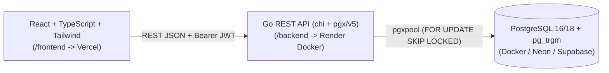

# Eneba Digital Game Marketplace

A full-stack digital game key marketplace modeled after **eneba.com**, built for the Eneba Software Engineer Internship assignment.

The platform implements a dynamic block-driven homepage, PostgreSQL `pg_trgm` typo-tolerant game search, multi-seller offer comparison, JWT authentication, and race-condition-free atomic digital key fulfillment.

---

## Live Demo & Reviewer Credentials

You can explore the catalog without signing in, create a new account via `/register`, or use the pre-seeded **Demo Buyer** account (also available as a one-click **Quick-fill** button on `/login`):

- **Email:** `gamer@eneba-demo.com`
- **Password:** `Password123!`

> Note: The Go backend idempotently seeds demo accounts (`gamer@eneba-demo.com` and `intern@eneba-demo.com`) at startup via `EnsureDemoUsers` in addition to `backend/migrations/002_seed.sql`.

---

## Architecture & Technical Choices



### 1. Go (`net/http` + `chi` + `pgx/v5`) Backend
- **Clean Layered Structure:** `router` ➔ `handlers` ➔ `services` ➔ `repository` ➔ `pgxpool`.
- **Typo-Tolerant Search (`pg_trgm`):** `products.title` has a GIN trigram index (`idx_products_title_trgm`). Queries in `GET /api/products?q=...` combine `similarity(title, $1) > 0.15`, `word_similarity($1, title) > 0.25`, and `ILIKE` fallback, ordered by `GREATEST(similarity, word_similarity) DESC` so queries like `q=cybrpunk` accurately rank *Cyberpunk 2077* first.
- **Dynamic Block-Driven Homepage:** `homepage_blocks` stores ordered CMS blocks (`hero_banner`, `best_sellers`, `flash_deals`, `recommended`) with JSONB `config`. `GET /api/homepage` batches product hydration (lowest price, discount %, live stock) so the React frontend renders zero hardcoded landing-page sections.
- **Atomic Digital Key Allocation (`FOR UPDATE SKIP LOCKED`):** `POST /api/orders/checkout` executes inside a single `pgx.Tx` transaction:
  1. Server-side lookup of authoritative `price_cents` from `seller_offers` (client-sent prices are ignored).
  2. Deterministic lock ordering (cart lines merged and sorted by `seller_offer_id`) to prevent deadlocks.
  3. `SELECT id, license_key FROM digital_keys WHERE seller_offer_id = $1 AND status = 'AVAILABLE' LIMIT $2 FOR UPDATE SKIP LOCKED` ensures concurrent buyers never lock or receive the same license key.
  4. On any shortage, the entire transaction rolls back and returns `409 Conflict` identifying the lacking offer and exact available count.

### 2. React + TypeScript + Vite + Tailwind Frontend
- **Eneba Visual Identity:** Deep violet-indigo canvas (`#1F0A4D`), saturated purple header/cards (`#4618AC` / `#37128A`), vibrant yellow CTAs (`#FFDC00`), and teal/emerald activation key badges (`#00D1B2` / `#19E3B1`).
- **End-to-End Purchase Flow:**
  - Persistent `Navbar` with live debounced search suggestions (`SearchBar`), `Cart` badge, and `AccountMenu`.
  - Dynamic `HomePage` (`/`), URL-synced `StorePage` (`/store`), multi-seller comparison `ProductPage` (`/product/:slug`), `CartPage` (`/cart`), redirect-preserving `AuthPage` (`/login`, `/register`), protected `CheckoutPage` (`/checkout`), `OrderDetailPage` (`/orders/:id`), and `OrdersPage` (`/orders`) with masked/revealable keys and one-click copy.

---

## Scope Decisions, Trade-offs & Shortcuts (7-Day Assignment)

- **Simulated Payment Gateway:** Checkout uses a `card_sim` payment mode (`Credit / Debit Card (Test Mode)`, `PayPal (Sandbox)`, `Eneba Wallet Demo`) instead of integrating a live Stripe webhook pipeline, allowing reviewers to test full transactional key allocation without real payment credentials.
- **Single-Currency Display (EUR):** Prices are stored as integer `price_cents` and formatted in EUR (`€`) on the frontend rather than adding multi-currency exchange rate tables.
- **Static Seeded Seller Catalog:** Seller offers and license keys are seeded via SQL migrations (`001_init.sql`, `002_seed.sql`) rather than building a separate seller onboarding portal/CRUD admin UI.
- **JWT Access Tokens in `localStorage`:** Short-lived HS256 JWTs (`72h` default) are stored in `localStorage` for simplicity across SPA reloads rather than HTTP-only refresh cookie rotation.

---

## Local Development Setup

### Prerequisites
- Go `1.22+`
- Node.js `20+` and `npm` (or `pnpm`)
- PostgreSQL `16+` (or Docker / Docker Compose)

### 1. Database & Environment
Start PostgreSQL with Docker (auto-runs `backend/migrations/001_init.sql` and `002_seed.sql`):
```bash
cp .env.example .env
docker-compose up -d postgres
```
Or point `DATABASE_URL` in `.env` to a local PostgreSQL / cloud Neon / Supabase instance and run `backend/migrations/001_init.sql` followed by `backend/migrations/002_seed.sql`.

### 2. Backend API
```bash
cd backend
go run ./cmd/api
```
The API listens on `http://localhost:8080` (`GET /api/health` returns `{"status":"ok","database":"connected"}`).

### 3. Frontend Storefront
```bash
cd frontend
cp .env.example .env
npm install
npm run dev
```
Open `http://localhost:5173`.

---

## Running Automated Tests

### Backend Integration Tests (Go + Live PostgreSQL)
Covers health check, dynamic homepage blocks, `pg_trgm` typo search, filtering/sorting, product detail & seller stock counts, user registration/login + demo user login, atomic checkout, `409 Conflict` rollback, and 8-way concurrent buyer race-condition safety:
```bash
cd backend
go test -v ./...
```

### Frontend Tests & Production Build
Covers cart reducer stock clamping, `CartPage`, unauthenticated redirects on `CheckoutPage` and `OrdersPage`, `OrderKeyCard` mask/reveal behavior, and `OrderDetailPage` receipt rendering:
```bash
cd frontend
npm test
npm run build
```

---

## Cloud Deployment (Neon / Supabase + Render + Vercel)

1. **PostgreSQL (Neon or Supabase):**
   - Create a PostgreSQL database and run `backend/migrations/001_init.sql` and `backend/migrations/002_seed.sql` in its SQL editor.
   - Copy the pooled/direct connection string with `?sslmode=require`.
2. **Backend (Render via `render.yaml` + `backend/Dockerfile`):**
   - Create a New Blueprint or Web Service on Render pointing to this repository (`rootDir: backend`, Docker runtime).
   - Set `DATABASE_URL` to your Neon/Supabase URI and `ALLOWED_ORIGINS` to your Vercel URL (e.g. `https://eneba-clone.vercel.app,http://localhost:5173`).
3. **Frontend (Vercel via `frontend/vercel.json`):**
   - Import the repository in Vercel with **Root Directory** set to `frontend`.
   - Set environment variable `VITE_API_URL` to your Render service URL (e.g. `https://eneba-marketplace-api.onrender.com`).
   - `frontend/vercel.json` handles SPA rewrites so refreshes on `/store`, `/product/:slug`, `/checkout`, and `/orders` resolve cleanly.

---

## AI-Assisted Workflow Log

A complete, chronological log of every user prompt, architectural plan, code change, and verification result is maintained in [`AGENT_LOG.md`](./AGENT_LOG.md).
