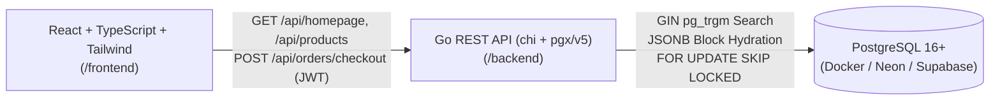

# Eneba Digital Game Marketplace


A full-stack digital game key marketplace modeled after **eneba.com**, built for the **Eneba Software Engineer Internship** assignment. It combines a dynamic CMS-driven storefront, PostgreSQL trigram fuzzy search, multi-seller offer comparison, JWT authentication, and race-condition-free atomic digital key allocation.

---

## Live Demo & Reviewer Quick-Start

| Service | Deployment URL | Purpose |
| :--- | :--- | :--- |
| **Live Frontend (Vercel)** | `https://<your-vercel-app>.vercel.app` | Interactive Storefront, Cart, Checkout & Key Vault |
| **Backend Health Check (Render)** | `https://<your-render-api>.onrender.com/api/health` | Verifies Go API & PostgreSQL connection pool |

### Pre-Seeded Reviewer Account
You can browse and search freely, register a new account at `/register`, or use the one-click **Quick-fill** demo button on `/login`:

- **Email:** `gamer@eneba-demo.com`
- **Password:** `Password123!`

> Note: `AuthService.EnsureDemoUsers` idempotently upserts both `gamer@eneba-demo.com` and `intern@eneba-demo.com` with valid `bcrypt` hashes at server startup alongside `backend/migrations/002_seed.sql`.

---

## System Architecture

```text
+-----------------------------------+        REST JSON + JWT         +------------------------------------------+
|     React 18 + TS + Tailwind      | -----------------------------> |     Go HTTP API (chi v5 + pgx/v5)        |
|  (/frontend -> Vercel SPA)        | <----------------------------- |  (/backend -> Docker / Render)           |
+-----------------------------------+                                +------------------------------------------+
                                                                                          |
                                                                                          | pgxpool (Tx + Row Locks)
                                                                                          v
                                                                     +------------------------------------------+
                                                                     |  PostgreSQL 16+ (pg_trgm + uuid-ossp)    |
                                                                     |  (Docker / Neon / Supabase)              |
                                                                     +------------------------------------------+
```



---

## End-to-End Purchase Flow

```text
[Homepage / Fuzzy Search]
       |  Dynamic JSONB blocks + pg_trgm typo-tolerant lookup (?q=cybrpunk)
       v
[Product & Multi-Seller Comparison]
       |  Compare seller ratings, stock counts, and prices -> Add to Cart
       v
[Cart Review (/cart)]
       |  Quantity clamped to live offer stock -> Proceed to Checkout
       v
[Authentication (/login?redirect=/checkout)]
       |  Register or Sign In (bcrypt + HS256 JWT) -> Auto-redirect back
       v
[Simulated Payment (/checkout)]
       |  POST /api/orders/checkout -> Atomic DB transaction locks keys
       v
[Order Receipt & Key Reveal (/orders/:id & /orders)]
          Reveal masked key, one-click Copy Key, or revisit Order History
```

---

## Key Engineering Highlights

1. **Typo-Tolerant Catalog Search (`pg_trgm`)**
   - `products.title` is indexed with a PostgreSQL GIN trigram operator index (`idx_products_title_trgm`).
   - `GET /api/products?q=...` scores matches using `GREATEST(similarity(p.title, $q), word_similarity($q, p.title))` alongside an `ILIKE` fallback, returning accurate top matches even for partial or misspelled queries (e.g., `q=cybrpunk` ➔ *Cyberpunk 2077*), combined with `platform`, `region`, `min_price`, `max_price`, and `sort` (`popular`, `price_asc`, `price_desc`, `newest`).

2. **Dynamic Block-Driven Homepage (`homepage_blocks` JSONB)**
   - `homepage_blocks` defines ordered layout sections (`hero_banner`, `best_sellers`, `flash_deals`, `recommended`) with arbitrary JSONB `config`.
   - `GET /api/homepage` collects all referenced `product_ids`, hydrates live lowest offer price, discount percentage, and total key stock in a single batched CTE query (`GetProductsByIDs`), and preserves exact block ordering so the React frontend contains zero hardcoded product sections.

3. **Concurrency-Safe Digital Key Fulfillment (`FOR UPDATE SKIP LOCKED`)**
   - `POST /api/orders/checkout` runs inside a single `pgx.Tx` database transaction:
     - Re-reads authoritative `price_cents` from `seller_offers` on the server (never trusts client-sent totals).
     - Merges duplicate cart lines and sorts them deterministically by `seller_offer_id` to prevent lock-order deadlocks.
     - Locks keys via `SELECT id, license_key FROM digital_keys WHERE seller_offer_id = $1 AND status = 'AVAILABLE' LIMIT $2 FOR UPDATE SKIP LOCKED`.
     - If any line lacks stock, rolls back the entire transaction and returns `409 Conflict` identifying the lacking `seller_offer_id`, `requested`, and `available` counts.
     - Otherwise inserts `orders` + `order_items`, updates locked keys to `status = 'SOLD'` with `order_item_id` and `sold_at`, and commits.

---

## Scope Decisions & Trade-Offs (7-Day Assignment Window)

| Area | Decision & Trade-Off | Rationale |
| :--- | :--- | :--- |
| **Payment Processing** | Hosted Stripe Checkout (Test Mode via `STRIPE_SECRET_KEY`) + automatic `card_sim` fallback | Uses server-verified EUR pricing and idempotent `stripe_session_id` fulfillment when configured, while staying runnable offline with zero external keys via the built-in sandbox simulator. |
| **Transactional Emails** | Async HTML welcome & key-delivery emails via Resend (`RESEND_API_KEY`) + `[EMAIL PREVIEW]` stdout logs | Dispatches non-blocking Eneba-styled HTML receipts on registration and order completion without delaying checkout or failing tests when no API key is set. |
| **Seller & Key Inventory** | Seeded via SQL migrations (`002_seed.sql`) + startup artwork/demo sync | Focuses engineering effort on buyer discovery, offer comparison, and concurrency-safe checkout rather than a merchant back-office CRUD portal. |
| **Pricing & Currency** | Integer `price_cents` displayed in EUR (`€`) | Prevents floating-point rounding bugs while avoiding multi-currency FX conversion tables within the 7-day scope. |
| **Session Storage** | HS256 JWT stored in `localStorage` (`72h` TTL) | Keeps cross-origin Vercel ➔ Render deployment straightforward without cookie `SameSite` / domain proxying complexity. |

---

## Project Directory Tree

```text
Eneba Project/
├── AGENT_LOG.md                   # Complete chronological log of AI-assisted turns
├── README.md                      # Project documentation & deployment guide
├── docker-compose.yml             # Local PostgreSQL 16 + auto-migrations
├── render.yaml                    # Render Blueprint for Go backend
├── .env.example                   # Root environment template
├── .gitignore
├── backend/
│   ├── Dockerfile                 # Multi-stage static Linux amd64 Go build
│   ├── go.mod / go.sum
│   ├── cmd/api/main.go            # Entrypoint, startup seed sync & graceful shutdown
│   ├── migrations/
│   │   ├── 001_init.sql           # Extensions (pg_trgm, uuid-ossp), tables & indexes
│   │   └── 002_seed.sql           # 16 games, 37 seller offers, 111 keys, 4 blocks, demo users
│   └── internal/
│       ├── auth/                  # HS256 JWT generation & verification
│       ├── config/                # Env config loader (ALLOWED_ORIGINS, DATABASE_URL)
│       ├── db/                    # pgxpool PostgreSQL pool & ping health check
│       ├── handlers/              # HTTP handlers + integration tests (catalog_test, checkout_test)
│       ├── middleware/            # JWT Bearer authentication middleware
│       ├── models/                # Strictly typed domain & API DTO structs
│       ├── repository/            # SQL queries, pg_trgm search & transactional checkout
│       ├── router/                # Chi router, CORS & public/protected route groups
│       └── services/              # Block hydration, auth validation & checkout orchestration
└── frontend/
    ├── vercel.json                # SPA rewrite rules for client-side routes
    ├── .env.example               # Frontend VITE_API_URL template
    ├── package.json
    ├── tailwind.config.js         # Eneba violet/yellow/teal theme tokens
    ├── scripts/run-tests.mjs      # esbuild + Node test harness
    ├── tests/purchaseFlow.test.mjs
    └── src/
        ├── api/                   # Typed fetch client & ApiError handling
        ├── components/            # Navbar, SearchBar, ProductCard, HeroBanner, PlatformBadge, OrderKeyCard
        ├── context/               # AuthContext & localStorage-persisted CartContext
        ├── pages/                 # HomePage, StorePage, ProductPage, CartPage, AuthPage, CheckoutPage, Orders
        ├── types/                 # TypeScript interfaces matching Go models
        └── utils/                 # Formatting, redirect sanitization, block parsers & hooks
```

---

## Local Setup & Automated Test Suite

### Prerequisites
- **Go** `1.22+`
- **Node.js** `20+` and **npm** (or **pnpm**)
- **PostgreSQL** `16+` (or Docker Compose)

### 1. Start PostgreSQL & Migrate
```bash
cp .env.example .env
docker-compose up -d postgres
```
*(Or point `DATABASE_URL` in `.env` to a local/Neon/Supabase PostgreSQL instance and run `backend/migrations/001_init.sql` then `backend/migrations/002_seed.sql`.)*

### 2. Run Backend & Integration Tests
The Go integration suite verifies health checks, dynamic homepage hydration, `pg_trgm` typo search (`q=cybrpunk`), filtering/sorting, multi-seller stock counts, auth, `409 Conflict` rollback, and 8-way concurrent buyer race-condition safety:
```bash
cd backend
go test -v ./...
go run ./cmd/api
```
API listens on `http://localhost:8080`.

### 3. Run Frontend & Automated Tests
The frontend test suite verifies `cartReducer` stock clamping, `CartPage`, unauthenticated redirects on `CheckoutPage` and `OrdersPage`, `OrderKeyCard` reveal/masking, and `OrderDetailPage`:
```bash
cd frontend
cp .env.example .env
npm install
npm test
npm run build
npm run dev
```
Storefront runs on `http://localhost:5173`.

---

### Optional Environment Variables (Stripe Test Mode & Emails)

The application runs out-of-the-box with simulated card checkout and stdout `[EMAIL PREVIEW]` logging. To enable hosted Stripe Test Mode or Resend HTML delivery, set these optional variables in `.env` (see [`backend/.env.example`](./backend/.env.example)):

- `FRONTEND_URL` — Base URL used for Stripe Checkout success/cancel redirects and email CTAs (default `http://localhost:5173`).
- `STRIPE_SECRET_KEY` — Stripe Test Mode secret key (`sk_test_...`). Enables `GET /api/config/payment` (`stripe_enabled: true`), `POST /api/checkout/stripe-session`, and idempotent fulfillment via `orders.stripe_session_id`.
- `RESEND_API_KEY` — Resend API key (`re_...`) for dispatching Eneba-styled welcome and key-delivery HTML emails asynchronously.
- `EMAIL_FROM` — Verified sender address (default `onboarding@resend.dev`).

---

## Cloud Deployment (Neon / Supabase + Render + Vercel)

1. **PostgreSQL (Neon / Supabase):** Run `backend/migrations/001_init.sql` and `backend/migrations/002_seed.sql`, then copy the connection URI with `?sslmode=require`.
2. **Backend (Render):** Deploy using `render.yaml` (`rootDir: backend`, Docker runtime). Set `DATABASE_URL` and `ALLOWED_ORIGINS` (your Vercel URL + `http://localhost:5173`).
3. **Frontend (Vercel):** Import the repo with **Root Directory** set to `frontend`, set `VITE_API_URL` to your Render URL, and deploy (`frontend/vercel.json` handles SPA rewrites).

---

## AI-Assisted Workflow

Every prompt, architectural plan, code change, and test verification across the entire build is recorded chronologically in [**`AGENT_LOG.md`**](./AGENT_LOG.md).
